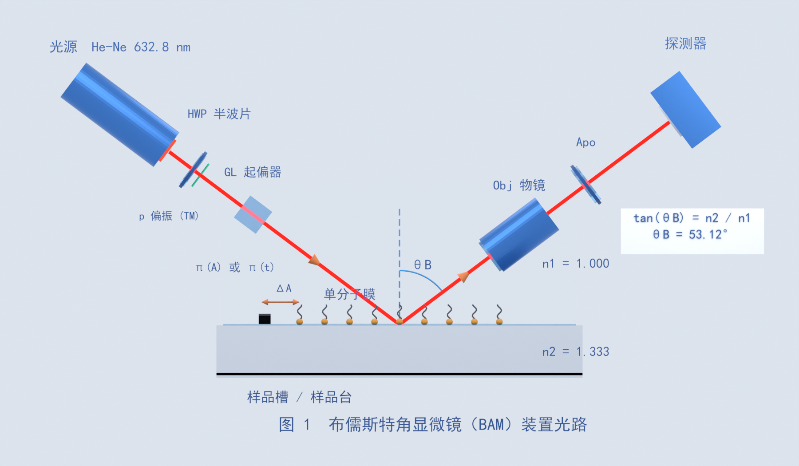

# 布儒斯特角显微镜（BAM）光机仿真与数值模型

一套针对空气/水界面单分子膜的布儒斯特角显微镜设计：p 偏振光以 θB = 53.12° 入射，膜区反射率仅 2.45×10⁻⁶，靠 10⁵ 量级消光比的起偏器把背景压到膜信号以下；Blender 建整机光机场景（119 对象、6 集合、56 项自检全通过），Python 按单层膜特征矩阵法算反射率、对比度、分辨率链与十项误差传递。

本目录是这套工作的可复用部分：建模脚本、数值模型、自检脚本、场景源文件、参数与设计文档。课程报告、录屏与含学号的提交包不在库内。



## 亮点

- **几何与物理同源**：Blender 与 Python 共用一套参数（λ、n₀/n_f/n_s、NA、像元、满阱），不会出现「图上是 A 型号、算的是 B 参数」；`tools/blender_audit.py` 从坐标独立反算入射角 53.123227°，与设计值差 1.7×10⁻⁶°。
- **可复现的定量结论**：ER ≥ 6.96×10⁴ 才满足 C = 1（GL10-A 余量 1.4×）；偏振消光比退化一项占十项误差绝对和的 84%；斜视清晰带只有 4.4 µm（视场 0.23%）。
- **文件自包含**：中文字体 pack 进 `.blend`、无外部贴图、建模脚本内嵌，换机不掉字且可一键重建。

## 目录

```
hw1-brewster-angle-microscope/
├── src/bam_build_scene.py        Blender 场景构建（119 对象 / 6 集合，参数化）
├── src/bam_model.py              特征矩阵反射率 + 十因素扫描 + 对准对焦计算（CLI）
├── src/make_film_figure.py       三层膜模型示意图
├── tools/blender_audit.py        56 项只读自检（含实际渲染一帧）
├── docs/                         需求、系统设计、物理模型、因素与误差、仿真约定、核实台账、自检报告
├── assets/bam_optical_path.blend 场景源文件（字体已打包）
├── data/                         4 份扫描 CSV + 结果摘要
└── scripts/sync.ps1              从本地作业目录同步最新成果并提交
```

## 快速开始

```bash
cd hw1-brewster-angle-microscope
pip install -r requirements.txt

# 1) 数值模型：重算 8 张曲线图 + 4 份 CSV + 摘要（约 6 s）
python src/bam_model.py

# 2) 三层膜示意图
python src/make_film_figure.py

# 3) 重建 Blender 场景并渲染两张预览（约 30 s）
blender -b --factory-startup --python src/bam_build_scene.py

# 4) 场景自检（只读，重新打开磁盘文件并渲染一帧）
blender -b assets/bam_optical_path.blend --python tools/blender_audit.py
```

关键输出：

```
裸界面 R_p(θB) = 0.000e+00      R_s(θB) = 0.078271
膜区 R_film = 2.452203e-06      灵敏度 dR/dd = 2.451678e-06 /nm
C = 1 所需 ER ≥ 6.96e4（GL10-A 1e5，余量 1.4×）
十因素最大项：偏振消光比退化 Δd = +31.6 nm（占绝对和 84%）
自检：total 56 / pass 56 / fail 0
```

## 文档

| 文件 | 内容 |
|---|---|
| [docs/requirements.md](docs/requirements.md) | 题目五项任务、装置示意图隐含的约束、提交要求 |
| [docs/system-design.md](docs/system-design.md) | 系统组成、六条选型准则、型号表、最终指标、商用对标、七步搭建、偏振定向 |
| [docs/physical-model.md](docs/physical-model.md) | 三层模型与特征矩阵、R∝d²、对比度与消光比判据、分辨率链、清晰带、色散温漂 |
| [docs/measurement-factors.md](docs/measurement-factors.md) | 十项因素扰动设定、ΔR/Δd 结果、A/B 类可消除性、对准与改进方向 |
| [docs/simulation.md](docs/simulation.md) | Blender 单位/坐标/位姿、集合分工、渲染设置、七个坑 |
| [docs/verified-parts.md](docs/verified-parts.md) | 9 类器件与 9 篇文献的联网核实台账（含未采纳信息） |
| [docs/verification.md](docs/verification.md) | 场景 56 项自检结果（脚本生成） |

## 已知局限

- **Blender 不做偏振追迹与相干叠加**：它只负责几何与可视化，物理量全部由 Python 计算；这是刻意的分工，不是缺陷。
- **三层模型假设膜层均匀各向同性**：真实单分子膜的亲水头基/疏水链区折射率不同，畴内织构源于面内各向异性，定量反演需有效介质近似。
- **器件几何为示意**：外形按厂商安装尺寸建模，镜筒长度、支撑杆直径做了简化，不按实物 1:1。
- **单帧、静态**：未做运动膜压缩过程的动态仿真，也未做 Scheimpflug 或 Z 扫描的实际验证。
- **`Apo` 为推断**：图只写缩写，按无限远校正光路还原为筒镜（Nikon MXA22018），待文献进一步确认。

## 说明

代码与文档用于学习交流，引用请注明出处；`.blend` 内不含第三方资产。若用于课程或论文，请自行核对所在单位的要求。
