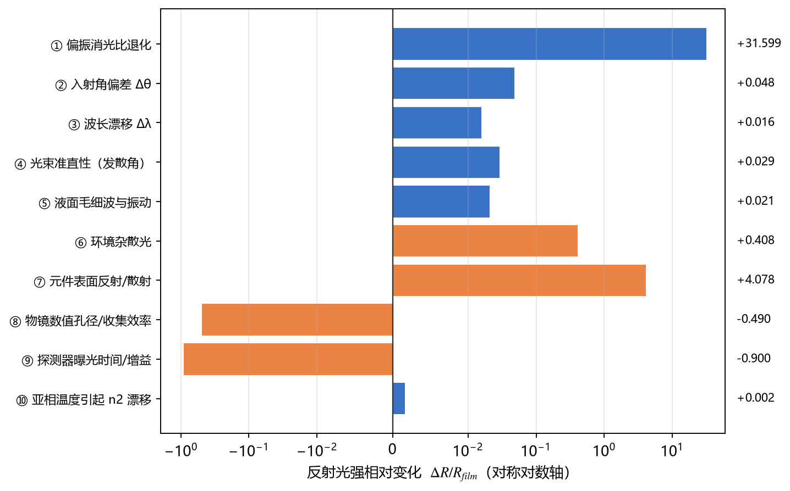
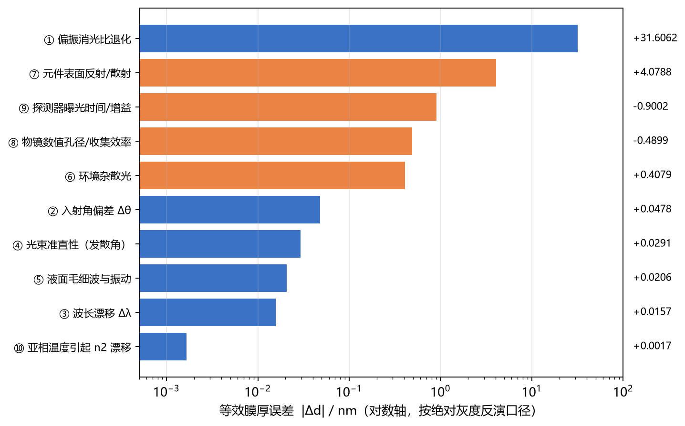

# 「除样品外」的影响因素与误差传递

> 对应题目第 4 项的「除样品外影响反射光强的其他因素」与第 5 项加分「这些因素对测量结果的影响」。
> 数值由 `src/bam_model.py` 生成，原始数据见 `data/ten_factors.csv`，中文摘要见 `data/summary-cn.txt`。

## 一、口径

题目限定「除样品外」，即不考虑膜自身折射率与厚度的变化，只考察仪器侧。把因素分四组共十项：光源侧（波长、准直、偏振）、光路侧（入射角、元件散射、杂散光）、探测侧（NA/收集效率、曝光增益）、环境侧（毛细波、温度）。

误差传递的口径是**绝对灰度反演**——用单幅图像灰度直接反算膜厚：

$$
\Delta d=\frac{\Delta R}{\mathrm{d}R/\mathrm{d}d},\qquad \mathrm{d}R/\mathrm{d}d=2.45\times10^{-6}\ \mathrm{nm^{-1}}
$$

若改用差分或比值法，折算关系会变，但**排序不变**。

因素分两类，这个分类不是形式，它决定能否用后处理消除：

- **A 类**：改变界面反射率本身（偏振、角度、波长、准直、毛细波、温度）→ 后处理无法消除，只能靠硬件与装调。
- **B 类**：改变测量链的信号或背景（散射、杂散光、NA、曝光）→ 缩放类可归一化消除，加性类需扣背景。

## 二、十项因素的扰动设定

| 编号 | 因素 | 扰动设定 | 依据 | 类别 |
|---|---|---|---|---|
| ① | 偏振消光比退化 | ER 由 1×10⁵ 降至 1×10³ | 起偏器老化、应力双折射、棱镜污染可退化两个量级 | A |
| ② | 入射角偏差 Δθ | +0.05° | 测角台绝对精度 0.02° 加装配误差 | A |
| ③ | 波长漂移 Δλ | +1 nm | HNL050L 纵模间隔 0.00058 nm，取远大于实际的保守上界 | A |
| ④ | 光束准直性 | 发散半角 ±1.0 mrad | HNL050L 标称发散角 1.0 mrad | A |
| ⑤ | 液面毛细波与振动 | 局部斜率 RMS 0.5 mrad | 开放液面在滑障运动与环境振动下的典型小扰动 | A |
| ⑥ | 环境杂散光 | 附加背景 1×10⁻⁶ I₀ | 实验室照明/桌面反射；遮光罩与窄带滤光片可抑制 | B |
| ⑦ | 元件表面反射/散射 | 等效杂散 1×10⁻⁵ I₀ | WPH05M-633 单面反射 <0.25%、GL10-A AR 面 <1% | B |
| ⑧ | 物镜 NA / 收集效率 | NA 0.28 → 0.20 | 换低倍或小孔径镜组时收集立体角下降 | B |
| ⑨ | 探测器曝光/增益 | 10 ms → 1 ms | 可编程曝光/自动曝光设置变化 | B |
| ⑩ | 亚相温度 | +2 °C（n₂ 漂移 1.84×10⁻⁴） | 温控精度、激光加热；dn/dT = −9.2×10⁻⁵ /°C | A |

② 的幅度取法有一个细节：成膜后 R_p 极小点右移到 θB + 0.0065°，若取 Δθ = +0.01° 会落在极小值左侧，算出**负的 ΔR**，物理上不成立；因此取 +0.05° 确保落在单调上升区。

## 三、结果（按 |Δd| 降序）

| 排名 | 因素 | ΔR | ΔR/R | 等效膜厚误差 Δd |
|---|---|---|---|---|
| 1 | ① 偏振消光比退化 | +7.75×10⁻⁵ | +31.6 | **+31.6 nm** |
| 2 | ⑦ 元件表面反射/散射 | +1.00×10⁻⁵ | +4.08 | +4.08 nm |
| 3 | ⑨ 探测器曝光/增益 | −2.21×10⁻⁶ | −0.90 | −0.90 nm |
| 4 | ⑧ 物镜 NA/收集效率 | −1.20×10⁻⁶ | −0.49 | −0.49 nm |
| 5 | ⑥ 环境杂散光 | +1.00×10⁻⁶ | +0.41 | +0.41 nm |
| 6 | ② 入射角偏差 Δθ | +1.17×10⁻⁷ | +0.048 | +0.048 nm |
| 7 | ④ 光束准直性 | +7.15×10⁻⁸ | +0.029 | +0.029 nm |
| 8 | ⑤ 液面毛细波与振动 | +5.06×10⁻⁸ | +0.021 | +0.021 nm |
| 9 | ③ 波长漂移 Δλ | +3.85×10⁻⁸ | +0.016 | +0.016 nm |
| 10 | ⑩ 亚相温度 | +4.05×10⁻⁹ | +0.002 | +0.002 nm |

*蓝：A 类改变反射率；橙：B 类改变测量链。对称对数轴。*

*折算成相对基准 d₀ = 2 nm 的等效膜厚误差。两图排序一致，因为 Δd 是 ΔR 的线性折算，只换了量纲。*

## 四、三点结论

1. **主导项单一**。① 一项的 Δd = 31.6 nm，占十项绝对值之和（约 37.6 nm）的 **84%**。BAM 的精度设计几乎可以缩成一句：把消光比稳在 10⁵ 以上、把杂散光压到 10⁻⁶ 量级，除 ⑦ 外其余八项贡献都在 1 nm 以下。
2. **B 类的可消除性不同**。⑧ ⑨ 是缩放类，用「减暗场 + 除以参考光强」即可消除；⑥ ⑦ 是加性背景，只能部分扣除，需另采一幅无膜区图像作背景；A 类后处理无解。
3. **噪声类不体现为偏置**。⑤ 毛细波与 ⑨ 曝光不足主要降低信噪比与畴边界识别精度；把它们折算成「等效膜厚误差」只为量级对比，不应读成系统偏差。

② 的 Δd = 0.048 nm 看起来很小，但它是 0.05° 偏差的结果；若偏差到 0.2°，有膜区 ΔR/R 升到约 0.97（R_p ∝ Δθ² 外推，与图 4 一致）。图 8 的橙色曲线从对比度角度给出同一结论：即使 ER 提到 10⁶，C 也只有 0.77，达不到 1。所以「角度不重要」是误解——正确说法是「θB 标定到 0.01° 后，剩余角度误差可接受」。

## 五、光路对准与图像对焦

### 对准

入射角偏差 Δθ 使反射光偏转 2Δθ，在筒镜（f = 200 mm）焦面上的光斑偏移为

$$
\Delta x=f\cdot 2\Delta\theta
$$

| Δθ | 光斑偏移 | 判定 |
|---|---|---|
| 0.01° | 0.0698 mm | 远小于像方靶面半宽 5.63 mm，可接受 |
| 2.0° | 13.96 mm | 超出视场，光斑丢失 |

这里有两个不同的「精度」容易混淆：**0.5° 容差**指「光斑还在不在视场内」，是机械对准问题；**0.01° 要求**指「零反射条件成不成立」，是角度标定问题。装调时先用 0.5° 把光斑找回来，再用 0.01° 把角度标定准，两者不能互相替代。

URS50BPP 分辨率 0.0014° 足以把对准误差控制在 0.01° 内（余量 7 倍）；其绝对精度 0.02° 决定 θB 标定的不确定度。

### 对焦

斜视下清晰带只有约 4.4 µm 全宽（占视场 0.23%），详见 [physical-model.md](physical-model.md) 第五节。这不是装配问题，是几何必然，只能靠 Scheimpflug 或 Z 扫描解决。

## 六、改进方向（按性价比排序）

1. **加 Scheimpflug 接口**：把清晰视场从 0.23% 扩到全视场，提升可用性最直接。
2. **差分偏振采集**：交替采 p 与 s 两幅图像相减，把 s 泄漏当共模量扣除，可把 ① 的 31.6 nm 压到 1 nm 量级；代价是帧率减半、两幅须严格配准。
3. **液晶偏振旋转器替代 HWP**：电控偏振调制，配合锁相采集抑制 1/f 噪声。

三条都不改光路拓扑，属渐进式改进。
