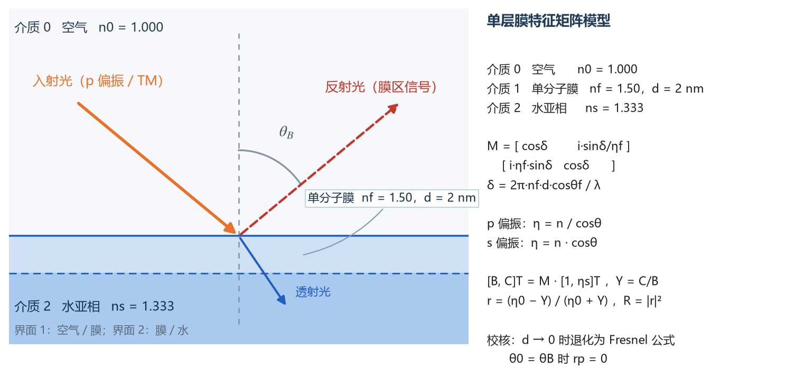
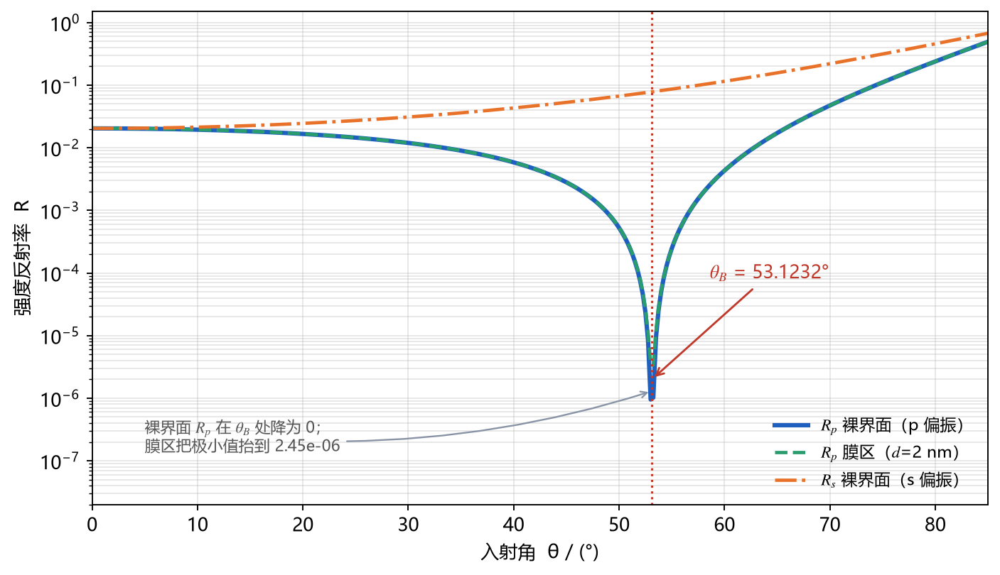
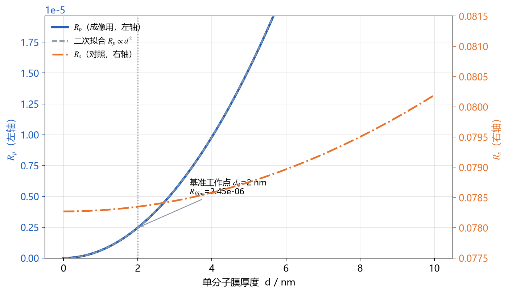
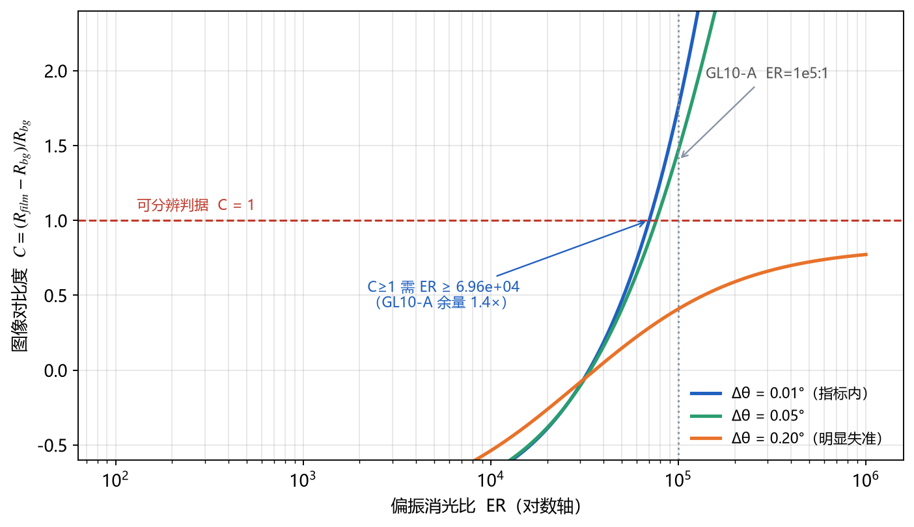
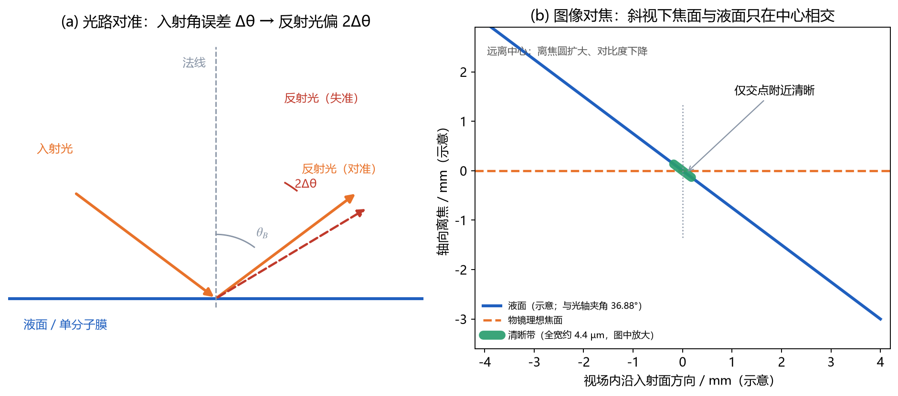
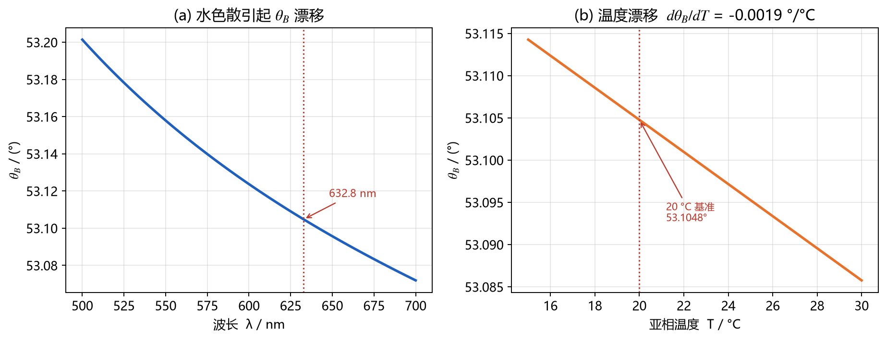

# 成像数学模型：反射率、对比度、分辨率与对焦

> 对应题目第 1 项的「成像系统数学模型」，以及第 4 项的对焦讨论。全部公式由 `src/bam_model.py` 实现，数值可在 `data/` 中复核。

## 一、三层介质与特征矩阵

单分子膜按「空气 / 膜 / 水」三层处理，膜层用**特征矩阵法**（Born & Wolf §1.6）：

$$
M=\begin{bmatrix}\cos\delta & \mathrm{i}\sin\delta/\eta_f\\ \mathrm{i}\,\eta_f\sin\delta & \cos\delta\end{bmatrix},\qquad
\delta=\frac{2\pi n_f d\cos\theta_f}{\lambda}
$$

其中光学导纳按偏振区分：

$$
p\ (\mathrm{TM}):\ \eta=\frac{n}{\cos\theta}, \qquad s\ (\mathrm{TE}):\ \eta=n\cos\theta
$$

界面总的输入导纳由 $[B,C]^{\mathrm T}=M\,[1,\eta_s]^{\mathrm T}$、$Y=C/B$，反射系数与反射率为

$$
r=\frac{\eta_0-Y}{\eta_0+Y},\qquad R=|r|^2
$$

$d\to0$ 时 $M$ 退化为单位矩阵，上式退化为裸界面的 Fresnel 公式；$\theta=\theta_B$ 时 $r_p=0$。这两条性质被写成脚本里的两项独立校核（见下）。

**模型边界**：三层模型假设膜层均匀、各向同性。实际单分子膜的亲水头基区与疏水链区折射率不同，存在明显的面内各向异性，BAM 图像的畴内织构正来源于此；若要定量反演分子排列，需引入有效介质近似或分层模型。

## 二、反射率与膜厚

θB 入射、n_f = 1.50、d₀ = 2 nm 时：

| 量 | 数值 |
|---|---|
| 裸界面 R_p(θB) | 0（浮点精确零） |
| 裸界面 R_s(θB) | 0.078271 |
| 膜区 R_film | 2.452×10⁻⁶ |
| 二次系数 k = R_film/d₀² | 6.13×10⁻⁷ nm⁻² |
| 灵敏度 dR/dd = 2k·d₀ | 2.45×10⁻⁶ /nm |

膜厚很小时 $R_p$ 与 $d^2$ 成正比（不是线性）：$R\approx k d^2$。这解释了为什么 BAM 对 2 nm 量级的膜仍有信号，也给出误差传递的分母——任何使 R 变化 ΔR 的因素都折算为

$$
\Delta d=\frac{\Delta R}{\mathrm{d}R/\mathrm{d}d},\qquad \mathrm{d}R/\mathrm{d}d=2.45\times10^{-6}\ \mathrm{nm^{-1}}
$$

注意：膜层会**移动** R_p 的极小点。d = 2 nm 时极小值出现在 θB + 0.0065°，所以只有当 |Δθ| > 0.0065° 时 R_p 才随 Δθ 单调上升。因素扫描取 Δθ = +0.05° 正是为了落在单调区（否则会算出负的 ΔR，物理上不成立）。

*0–85° 的 p/s 反射率（对数纵轴）。裸界面在 θB 处降为零，膜区把极小值抬到 2.45×10⁻⁶。*

*θB 入射下 R_p 与 R_s 随膜厚变化（双纵轴）。两条曲线量级差四个数量级，同轴会把 R_p 压成直线。*

## 三、对比度与消光比判据

BAM 的「信号」是膜区与背景的差。设膜区反射 $R_\mathrm{film}$、背景 $R_\mathrm{bg}$：

$$
C=\frac{R_\mathrm{film}-R_\mathrm{bg}}{R_\mathrm{bg}}
$$

背景由两部分构成：s 偏振泄漏 $R_s/\mathrm{ER}$（ER 为起偏器消光比）与仪器基准杂散 $R_\mathrm{stray}=1\times10^{-7}$（遮光罩 + 632.8 nm 窄带滤光片后的残差）。

判据：C ≥ 1 为可分辨。代入 $R_\mathrm{film}=2.452\times10^{-6}$、$R_s=0.0783$，

$$
\frac{2.452\times10^{-6}}{0.0783/\mathrm{ER}+10^{-7}}\ge1
\;\Rightarrow\;\mathrm{ER}\ge6.96\times10^{4}
$$

GL10-A 的 1×10⁵ 给出 **1.4× 余量**。这条判据把「选多大消光比」变成可算的硬指标，也是选型准则里消光比排第一的原因。

*横轴消光比（对数），三条曲线对应 Δθ = 0.01° / 0.05° / 0.20°。图上标出 C = 1 所需的 ER 与 GL10-A 的实际值。*

## 四、分辨率链

系统是否「衍射受限」要沿链核算：

| 环节 | 计算 | 结果 |
|---|---|---|
| 物镜衍射极限（⊥入射面） | $0.61\lambda/\mathrm{NA}=0.61\times632.8/0.28$ | 1.379 µm |
| 斜视投影修正 | $1.379/\cos 53.123°$ | 2.297 µm ≈ 2.30 µm |
| 像元对应物面尺寸 | 5.5 µm / 10× | 0.550 µm |
| Nyquist 上限 | 1.379 / 2 = 0.689 µm（采样间隔须小于分辨率的一半） | 0.689 µm |
| 判定 | 0.550 < 0.689 | 相机不拖后腿 |
| 视场 | 2048 × 0.55 µm；×1.666 | 1.126 × 1.876 mm |

结论：**系统为衍射受限**——分辨率由 NA 决定，不是由相机决定。要提升只能换更高 NA 物镜，但 NA 提高会缩短工作距，与跨槽壁需求冲突。

## 五、对焦：斜视下的清晰带

液面与光轴夹角为 $90°-\theta_B=36.88°$，即液面与焦面夹角为 θB。沿液面距交点 x 处的轴向离焦为

$$
\Delta z(x)=x\cos 36.88°=x\sin\theta_B
$$

物镜标称景深 3.5 µm（全深），则清晰带沿液面的全宽为

$$
W=\frac{\mathrm{DOF}}{\sin\theta_B}=\frac{3.5\ \mu m}{\cos 36.88°}\approx4.4\ \mu m
$$

半宽约 2.2 µm。相对 1.88 mm 的视场长度，清晰带只占 **0.23%**——这就是商用 BAM 说明书里「图像仅聚焦在视场中心」的由来。注意这里除以 $\sin\theta_B$ 而不是 $2\sin\theta_B$：3.5 µm 已是全深，不要再除以 2。

工程解法：Scheimpflug 倾斜相机（把焦面转到与液面重合），或 Z 轴扫描拼接。

*（a）入射角偏差 Δθ 使反射光偏 2Δθ，在筒镜焦面上偏移 $f\cdot2\Delta\theta$；（b）斜视清晰带。*

## 六、布儒斯特角的色散与温度

水的折射率随波长与温度变化，θB 随之漂移：

| 项 | 数值 | 影响 |
|---|---|---|
| 色散（Daimon–Masumura） | 543 nm → 53.163°；632.8 nm → 53.105°；659 nm → 53.091° | 632.8 nm 附近斜率 ≈ −5.4×10⁻⁴ °/nm；换到 543 nm 累计 0.058°，**必须重新标定** |
| 温度 | dn/dT = −9.2×10⁻⁵ /°C → dθB/dT = −0.0019 °/°C | 30 °C 时降到 53.0858°；1 °C 波动对应 ΔR_p ≈ 1.8×10⁻⁹，比膜信号小约 1400 倍，可忽略 |

**双口径说明**：几何按教学基准 n₂ = 1.333（θB = 53.1232°）建；指标与误差按实测 n₂ = 1.332106（θB = 53.1048°）算。两者差 0.0185°，使裸界面 R_p 从 0 变为约 2.2×10⁻⁸（约膜信号的 1%）。文档中凡涉及处均注明用的是哪一套。

*左：θB 随波长（水的色散）；右：θB 随温度。*

## 七、三项代码校核

写完后先校核物理实现，再进入因素扫描：

1. **退化校核**：d = 0 时特征矩阵应为单位阵，`reflectance()` 应与独立实现的 `fresnel_R()` 一致。0–85°、1001 点 × p/s 两偏振，最大绝对偏差 **2.83×10⁻¹⁵**（双精度机器精度）。
2. **零点校核**：θ = θB、d = 0 时 R_p = 0（浮点精确零）。θB 由 arctan(n₂/n₁) 反算，Fresnel 分子恰好抵消。
3. **二次关系校核**：k·d₀² = 2.452×10⁻⁶ 复现 R_film；解析灵敏度 2k·d₀ = 2.452×10⁻⁶ /nm 与数值差分一致（相对差 2.1×10⁻⁴）。

这三项只证明「代码算的是它该算的东西」，不证明模型适用于真实样品——模型边界见第一节。
