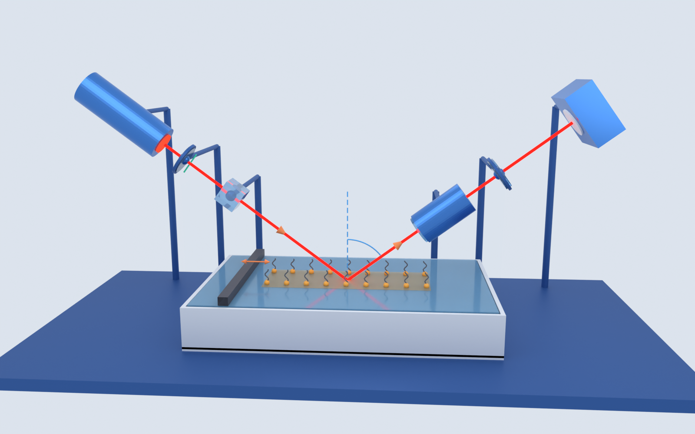
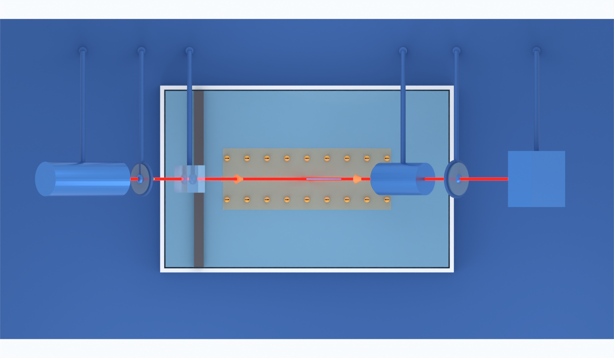
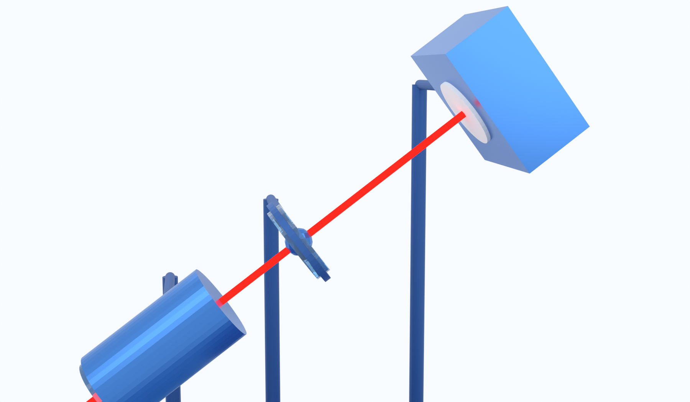

# Blender 光机仿真：约定、结构与踩坑记录

> 场景由 `src/bam_build_scene.py` 用 bpy 参数化重建，源文件为 `assets/bam_optical_path.blend`。
> 自检结果见 [verification.md](verification.md)（56/56 PASS）。

## 一、工具分工与选择理由

课程允许 Zemax / Blender / VirtualLab 三选一。本设计用「Blender + Python 数值计算」组合：

- **Blender 回答「装得下、对得准、看得见」**：在真实尺度下摆放器件，暴露干涉、遮挡、支撑不合理的问题——这些在二维示意图上永远看不出来。
- **Python 回答「信号有多强、误差有多大」**：按特征矩阵法算反射率、扫因素、算信噪比与误差（见 [physical-model.md](physical-model.md)）。
- 两条线**共用一套参数**（λ = 632.8 nm、n₀/n_f/n_s、NA 0.28、像元 5.5 µm、满阱 11.9 ke⁻），不会出现「图上是 A 型号、算的是 B 参数」。

选 Blender 的三条理由：能在真实尺度摆件并输出正交侧视+透视总览（满足「真实世界的可视化」）；自带 Python 接口，场景可脚本化重建，改型号只改一行；能暴露三维干涉。

Blender 的边界必须讲清楚：**它不做偏振追迹、不做相干叠加**，给不出 Fresnel 反射率与消光比。所以物理量全部由 Python 算。若要一个软件同时做几何与光学，Zemax 非序列模式更合适；VirtualLab 的傅里叶模态法适合光栅类结构，对均匀薄膜是过度设计。



## 二、单位与坐标约定

| 项 | 设置 |
|---|---|
| 单位制 | METRIC，`scale_length = 0.01` → **1 Blender Unit = 1 cm** |
| 原点 | 液面与入射光交点 |
| 坐标轴 | +X 沿液面指向反射侧；+Y 垂直纸面向里；+Z 竖直向上；入射面为 XZ（y = 0） |
| 法线 | +Z |
| 入射方向 | $(\sin\theta_B,0,-\cos\theta_B)=(0.799928,0,-0.600096)$ |
| 反射方向 | $(0.799928,0,+0.600096)$ |
| p 偏振电场 | $(\cos\theta_B,0,\sin\theta_B)$，在入射面内且 ⊥ 传播方向 |

**不要用 3-4-5 近似**：tanθB = 1.333 时精确分量对应 53.1232°，而 3-4-5 对应 53.1301°，差 0.0069°。场景里存的是精确分量，自检的 D 类才反算出 53.123227°。

把方向写成单位向量后，所有器件位置 = 「距原点距离 × 方向」，几何关系一目了然。

## 三、器件位姿（.blend 实测坐标）

| 器件 | 型号 | 坐标 (x, y, z) / cm | 光轴方向 | 距液面 / cm |
|---|---|---|---|---|
| 光源 | Thorlabs HNL050L | (−16.80, 0, 12.60) | (0.8, 0, −0.6) | 21.00 |
| 半波片 | Thorlabs WPH05M-633 | (−12.40, 0, 9.30) | (0.8, 0, −0.6) | 15.50 |
| 起偏器 | Thorlabs GL10-A | (−8.80, 0, 6.60) | (0.8, 0, −0.6) | 11.00 |
| 物镜（前透镜） | Mitutoyo 378-803-3 | (5.50, 0, 4.13) | (0.8, 0, 0.6) | 6.88 |
| 筒镜 | Nikon MXA22018 | (11.20, 0, 8.40) | (0.8, 0, 0.6) | 14.00 |
| 探测器靶面 | Basler acA2040-90um | (16.27, 0, 12.21) | (0.8, 0, 0.6) | 20.34 |
| 滑障 | — | (−8.10, 0, 0.34) | 行程沿 X | — |

坐标自洽检查：21.00 × 0.7999 = 16.80、21.00 × 0.6001 = 12.60，说明光源严格落在入射射线上；筒镜 14.00 × 0.7999 = 11.20、×0.6001 = 8.40；靶面同理。这条检查被写进自检脚本的 D 类，作为「器件是否在光轴上」的判据（六个光学器件偏离光轴 < 0.12 cm、光轴与光束夹角余弦 > 0.995）。



*附图：俯视布局。入射臂与成像臂都落在 y = 0 的竖直平面内，槽体关于原点对称。*



*附图：探测臂局部。物镜—筒镜—探测器严格共线；筒镜与探测器间距须等于 f = 200 mm，图中为示意比例。*

## 四、场景结构

119 个对象，6 个集合，分集合的目的是**渲染时可整组隐藏**：

| 集合 | 内容 |
|---|---|
| 01_光源与起偏臂 | 激光器、HWP、GL、光阑、入射光束 |
| 02_样品台与单分子膜 | 槽体、亚相、18 头基 + 18 疏水链、滑障 |
| 03_反射成像臂 | 物镜、筒镜、探测器、反射光束 |
| 04_机械支撑 | 立柱 6、悬臂 6、关节 6 |
| 05_标注与辅助 | 文字、θB 圆弧、法线虚线（11 段）、公式白板 |
| 06_灯光与相机 | 3 盏灯、2 台相机 |

每件用基本体组合，不追求外观：激光器是圆柱加散热片，HWP/GL 是圆柱内嵌方体，物镜是阶梯圆柱，探测器是方壳加圆靶面，槽体是长方体挖空。

## 五、标注与渲染

- **侧视图承担全部标注**：器件名、θB 圆弧（画在**反射侧**，与题面图一致）、n₁/n₂ 分区、tanθB 公式框、光路箭头。
- **立体图不承担标注**：渲染时临时隐藏 FONT 与公式白板，只展示三维结构。立柱与标注同轴，透视下必然穿插，这不是缺陷而是分工。
- 侧视正交相机 (0, −40, 5.5)，`ortho_scale = 48 cm`，覆盖光源到探测器约 33.1 cm 的 X 向跨度并留标注空间；输出 1800×1050。
- 透视相机 (3.5, −50, 15.5)，35 mm，输出 1600×1000。
- Cycles / CPU / 48 采样 / PNG；view transform 用 `Standard` + `Medium High Contrast`（AgX 会把红光压成粉白）。
- 保存 .blend 前所有 `hide_render` 恢复 False，交付态可完整渲染。

## 六、文件自包含（换机可复现）

| 项 | 处理 | 结果 |
|---|---|---|
| 中文字体 | 只加载 1 份 SimHei 并 `pack()` 进文件（初版每对象各加载一份，18 份重复，12 MB） | 文件 5.0 MB，换机/换目录不掉字；自检「字体 2 个、未打包 0 个」 |
| 外部图像 | 无贴图，材质全程序化 | 无未打包依赖 |
| 内嵌脚本 | `bpy.data.texts.load(os.path.abspath(__file__))` 把本脚本嵌入 | 打开 .blend 即可看源码；自检逐字比对通过 |
| 内嵌参数表 | `BAM_仿真参数与器件位姿表.txt`（43 项场景参数） | 打开即可查 |

## 七、踩坑记录（按严重程度）

1. **字体未打包**（P0）。初版 18 份 SimHei datablock 全 `packed=False`，filepath 指向绝对路径，换机必掉中文。改全局缓存 + `font.pack()`，5.0 MB 自包含。
2. **θB 圆弧画在入射侧**（P1）。题面图标在法线右侧（反射侧），初版画在左侧。改为镜像参数 `90° − θB·i/24`，弧与文字一起移到右侧。
3. **立柱贯穿公式框**（P1）。立柱若放 y = −9.6 会穿过公式白板与标注文字。统一移到 +Y 侧（y = +9.6），两处问题同时解决。
4. **单分子膜示意过大**（P1）。初版头基球太大、链条太密，红光穿过时被完全挡住，看着像「光被膜吸收」。实际膜厚 2 nm，遮挡可忽略。缩到头基 Ø0.16 cm、链高 0.6 cm。
5. **n₂ 文字被水体遮挡**（P2）。n₂ 标在 y = 0 会被半透明水体挡住，前置到 y = −7.2。
6. **浮点容差过严**（P2）。自检用 `mathutils.Vector`（float32）反算角度，1e-6° 容差必然失败；改 1e-3°。
7. **辅助对象缺属性**（P2）。两个传播方向箭头漏写自定义属性，补上并加「全对象兜底」循环，保证无遗漏。

## 八、复现命令

```bash
# 场景（需 Blender 4.x/5.x；只用 bpy）
blender -b --factory-startup --python src/bam_build_scene.py

# 自检（重新打开磁盘文件，含实际渲染一帧）
blender -b assets/bam_optical_path.blend --python tools/blender_audit.py
```

第一条会重写 `assets/bam_optical_path.blend` 并重渲 `docs/images/preview_side.png`、`preview_3d.png`（约 30 s）。自检不修改文件。
