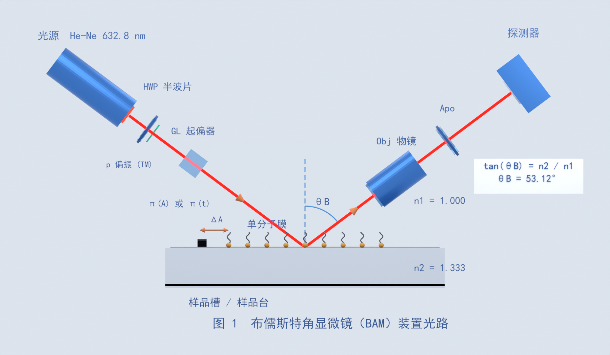

# 系统设计：组成、选型与最终指标

> 本文件对应题目第 1—3 项：系统组成与功能、部件选型与整机方案、最终指标、搭建过程与偏振定向。
> 所有型号均经厂商官方页核实，逐条参数与来源见 [verified-parts.md](verified-parts.md)。

*侧视正交渲染（1 Blender Unit = 1 cm）。光源 → HWP → GL → 液面 → Obj → Apo → 探测器，θB 圆弧画在反射侧。*

## 一、系统组成

| 部分 | 组成 | 承担的功能 | 设计要点 |
|---|---|---|---|
| 光源与起偏臂 | He-Ne 激光器、半波片、Glan-Laser 棱镜 | 提供单色线偏振光，并把消光比提到 10⁵ | 核心指标不是功率而是**消光比**——它决定背景能否压到膜信号以下 |
| 样品台与 Langmuir 槽 | PTFE 槽体、双滑障、Wilhelmy 铂金板、测角台 | 盛亚相、压缩成膜、测表面压 π，并把液面调到 θB | 液面既是光学界面又是力学界面，样品本身在动，光路必须跟着稳 |
| 反射成像臂 | 长工作距物镜、筒镜、面阵探测器 | 在 53° 斜视下收集膜区微弱反射并成像 | 工作距须大于槽壁高度；斜视使景深、分辨率、照度全部被投影压缩 |
| 机械支撑与调整 | 立柱、悬臂、关节、测角台、旋转座 | 把器件稳定送到光路并提供俯仰/偏摆微调 | 立柱与标注、光束、槽体的干涉只有在三维场景里才看得出 |
| 控制与采集 | 相机曝光、滑障运动、表面压记录 | 图像与 π 同步记录 | 图像必须与表面压打同一时间戳，否则形貌变化无法与等温线对应 |

## 二、器件链与选型结果

| 图中标注 | 器件 | 功能 | 型号 | 关键参数 |
|---|---|---|---|---|
| — | 激光光源 | 632.8 nm 单色线偏振光 | Thorlabs HNL050L | 5.0 mW；偏振比 500:1；TEM₀₀ >95%；1/e² 光斑 0.81 mm；发散角 1.0 mrad；纵模间隔 435 MHz |
| HWP | 半波片 | 无损旋转偏振面 | Thorlabs WPH05M-633 | 633 nm 零级（复合）；延迟精度 <λ/300；孔径 10 mm；波前 λ/8；20-10 |
| GL | Glan-Laser 起偏棱镜 | 把消光比提到 10⁵ | Thorlabs GL10-A | 消光比 1×10⁵:1；AR 350–700 nm；孔径 10 mm；CW 500 W/cm²；波前 λ/4 |
| — | Langmuir 槽 / 样品台 | 承载液面、压缩成膜、测 π | Biolin KSV NIMA Medium（KN 2002） | 273 cm²；双滑障 0.1–270 mm/min（精度 0.1 mm/min）；π 0–300 mN/m；天平 0.1 µN/m；压缩比 10.8 |
| Obj | 长工作距物镜 | 53° 斜视收集成像 | Mitutoyo M Plan Apo 10X（378-803-3） | 10×；NA 0.28；WD 34.0 mm；f = 20 mm；景深 3.5 µm；校正 436–656 nm |
| Apo | 筒镜（由无限远光路推断） | 把平行光会聚到靶面 | Nikon MXA22018 | f = 200 mm；物镜肩后约 100 mm |
| — | 面阵探测器 | 光电转换 | Basler acA2040-90um | 2048×2048；像元 5.5 µm；90 fps；QE 62.07%；满阱 11.9 ke⁻；暗噪声 13.8 e⁻；全局快门 |
| — | 精密测角/旋转 | θB 标定与偏振定向 | Newport URS50BPP；Thorlabs PRM1Z8 | 分辨率 0.0014°、绝对精度 ±0.02°；PRM1Z8 增量 25″（≈0.0069°） |

## 三、选型准则（六条）

BAM 的选型约束来自「弱信号、斜入射、液面」，可归纳为六条，**按优先级排列**：

1. **波长与功率**。632.8 nm 是传统工作波长：水吸收小、膜/水折射率对比合适、硅探测器 QE 高。功率不需大——5 mW 经起偏与折转后到样品约 1 mW，10 ms 曝光即接近满阱；功率过大反带来热漂移与样品损伤。
2. **消光比优先于其他光学指标**。C = 1 判据要求 ER ≥ 6.96×10⁴（见 [physical-model.md](physical-model.md) 对比度一节），工程取 10⁵ 留 1.4× 余量。
3. **入射角精度优于 0.01°**。θB 附近 R_p 对角度极敏感：Δθ = 0.05° 时裸界面 R_p 升到 1.58×10⁻⁷，有膜区 ΔR ≈ 1.17×10⁻⁷（约膜信号的 5%）。测角机构分辨率应优于 0.01°，且重复性要好。
4. **物镜**。工作距 > 槽壁高度（否则镜筒遮挡入射光或碰槽壁）；NA 兼顾分辨率与收集效率；必须无限远校正才能配筒镜。
5. **探测器**。像元满足 Nyquist；满阱大以容纳 s 泄漏背景；帧率跟得上压缩过程；全局快门避免运动畸变。
6. **样品台**。槽体不污染亚相；滑障速度可调且稳；表面压分辨力优于 0.1 mN/m（KSV NIMA Medium 的 0.1 µN/m 高三个数量级）。

两处配套关系值得记住：

- **光源功率与满阱是配套的**。5 mW 决定了 10 ms 曝光接近满阱；若换 50 mW（如商用 MicroBAM），必须加中性密度滤光片，否则 1 ms 即饱和，反而失去曝光调节余地。
- **NA 与工作距是互斥的**。NA 提高→分辨率提高，但工作距缩短，与 34 mm 跨槽壁需求冲突。这是 BAM 物镜选型的核心矛盾，10×/NA 0.28/WD 34 mm 是折中解。

## 四、最终指标

| 指标 | 数值 | 依据与说明 |
|---|---|---|
| 光源波长（单线） | 632.8 nm | HNL050L 无调谐；纵模间隔 435 MHz 对应 0.00058 nm，可视为单色 |
| 可换波长 | 543 / 632.8 / 659 nm | 换波长时 θB 变为 53.163° / 53.105° / 53.091°，最大差 0.072°，必须重新标定 |
| **入射角精度** | **±0.01°** | 测角台分辨率 0.0014°、绝对精度 0.02°；对应裸界面 ΔR_p ≈ 6.3×10⁻⁹，等效膜厚误差约 0.003 nm |
| **分辨率（⊥入射面）** | **1.38 µm** | Rayleigh 0.61λ/NA，NA = 0.28 |
| **分辨率（∥入射面）** | **2.30 µm** | 含斜视投影因子 1/cosθB = 1.666 |
| 物面采样 | 0.55 µm | 5.5 µm 像元 / 10×，优于 Nyquist 要求 0.689 µm |
| 视场 | 1.13 × 1.88 mm | 2048 × 0.55 µm；沿入射面乘 1.666 |
| 图像对比度 | C₀ ≈ 1.8 | ER = 1×10⁵、基准背景 1×10⁻⁷；仅计 s 泄漏时 C ≈ 2.13（R_film/R_bg = 3.13） |
| 帧率 | 90 fps（全幅） | ROI 缩至 512×512 可到 300 fps 以上 |
| 入射角范围 | 40°–70° 连续 | 测角台 360° 连续；实际受槽壁与工作距限制 |

「光源波长范围」一项要避免误解：He-Ne **没有调谐能力**，波长范围实际是「单线」；若换 543/659 nm 光源，θB 随水色散变化，测角台必须重新标定。

## 五、与商用 BAM 对标

| 机型 | 入射角 | 光源 | 图像分辨率 | 视场 |
|---|---|---|---|---|
| KSV NIMA MicroBAM（现行） | 固定 53° | 659 nm / 50 mW | 12 µm | 3.6 × 4.0 mm |
| KSV OPTREL MicroBAM（早期） | 固定 53° | He-Ne 633 nm / 10 mW | 2 µm（CCD 640×480） | — |
| 本方案 | 40°–70° 可调，标定 ±0.01° | 632.8 nm / 5 mW | 2.30 µm（∥入射面） | 1.13 × 1.88 mm |

本方案分辨率优于现行 MicroBAM（2.30 µm vs 12 µm），视场小约 2 倍，差异来自物镜倍率：MicroBAM 用低倍长工作距物镜换大视场，本方案用 10× 换分辨率。两代商用机都注明「因观察角度原因，图像仅聚焦在视场中心」——这与下面的对焦计算完全对应，商用机没有解决，只是写进了说明书。

## 六、搭建流程（七步）

| 步骤 | 内容 | 关键控制量 | 检验方法 |
|---|---|---|---|
| 1 | 平台与槽体 | 水平度优于 0.1°；液面低于槽壁 2 mm | 气泡水平仪；钢尺 |
| 2 | 入射臂装配 | 光轴高度 = 液面高度；三件同轴 | 两支光阑找正，看同心度 |
| 3 | **θB 标定** | 转到 53.10°（按实测 n₂），误差 ±0.01° | 远处屏上光斑位置反查 |
| 4 | **偏振定向** | 消光比达 10⁵ 量级 | 旋转一周出现两个极小值 |
| 5 | 成像臂装配 | 反射光斑落在物镜入瞳中心 | 相机实时图像 |
| 6 | 对焦 | 清晰带位于视场中心 | 刀口法或对比度峰值搜索 |
| 7 | 联调 | 图像与 π 时间戳对齐 | 滴膜压缩全过程记录 |

第 3、4 步顺序不能颠倒：先调偏振、后调角度，角度一动偏振方向就偏了。第 6 步不能沿用普通显微镜「调到最清楚」的经验——斜视下视场内永远只有一部分清楚，应先找清晰带、再把它调到视场中心（见 [physical-model.md](physical-model.md) 的清晰带计算）。

## 七、入射光偏振方向的确定

BAM 不靠几何标记定向（标记精度只有 ±2°，而要求 0.1° 量级），靠**消光判据**。四步：

1. **粗定**。HNL050L 输出已是线偏振，偏振面由激光头标记给出。把 HWP 快轴转到与激光偏振面成 45°，输出仍线偏振但方向转 90°。目的是不转动激光头就改变偏振方向，避免破坏准直。
2. **精定**。在样品位置放裸硅片或黑玻璃（高反射、不成膜、不产生膜信号），HWP 与 GL 一起绕光轴旋转，同时监视反射光斑亮度。p 偏振严格位于入射面内时 θB 下 R_p 极小，光斑最暗。
3. **判据**。旋转一周应出现**两个**极小值（HWP 每转 45°，偏振面转 90°，p 与 s 互换）。极小处残余亮度对应实际消光比：与 GL10-A 标称 10⁵ 相符说明定向正确；残余亮度偏高说明 GL 前偏振不纯，或 HWP 延迟偏离 λ/2。
4. **锁定**。HWP 与 GL 锁死，记录旋转座读数；换样品、换波长按读数复位。

定量依据：偏振面偏离 p 方向 α 时，混入的 s 分量占 sin²α，残余反射约 R_s·sin²α。θB 处 R_s = 0.0783，2 nm 膜区 p 信号仅 2.45×10⁻⁶，相差约 3.2×10⁴ 倍。α = 1° 时残余反射约 2.4×10⁻⁵，是膜信号的 10 倍；要让残余降到膜信号以下需 α < 0.18°。所以容差是 0.1° 量级，必须用消光法定量，目测或按标记安装都不够。

注意区分两种「角度偏差」：图 4 反映的是**入射角偏差**对 R_p 的影响；这里是**偏振面偏角**，两者是不同扰动，不能混用。

工程细节：消光时光斑极暗，可临时把曝光调到 100 ms，或用目视加毛玻璃屏；完成后必须恢复曝光，否则采图饱和。

## 八、设计取舍记录

- **建模基准 vs 实测**：几何按教学基准 n₂ = 1.333（θB = 53.1232°）建，便于与题面 `tanθB = n2/n1` 对应；指标与误差按 Daimon–Masumura 实测 n₂ = 1.332106（θB = 53.1048°）算。两者差 0.0185°，使裸界面 R_p 从 0 变为约 2.2×10⁻⁸（约膜信号的 1%）。
- **Apo 的还原**：图只写 `Apo`。按无限远校正光路还原为筒镜（Nikon MXA22018），属推断；`GL` 有文献直接支撑，属确认。文档中两者措辞分开。
- **示意而非 1:1**：器件外形按厂商安装尺寸建模，但镜筒长度、支撑杆直径做了简化，目的是让几何关系清楚。
