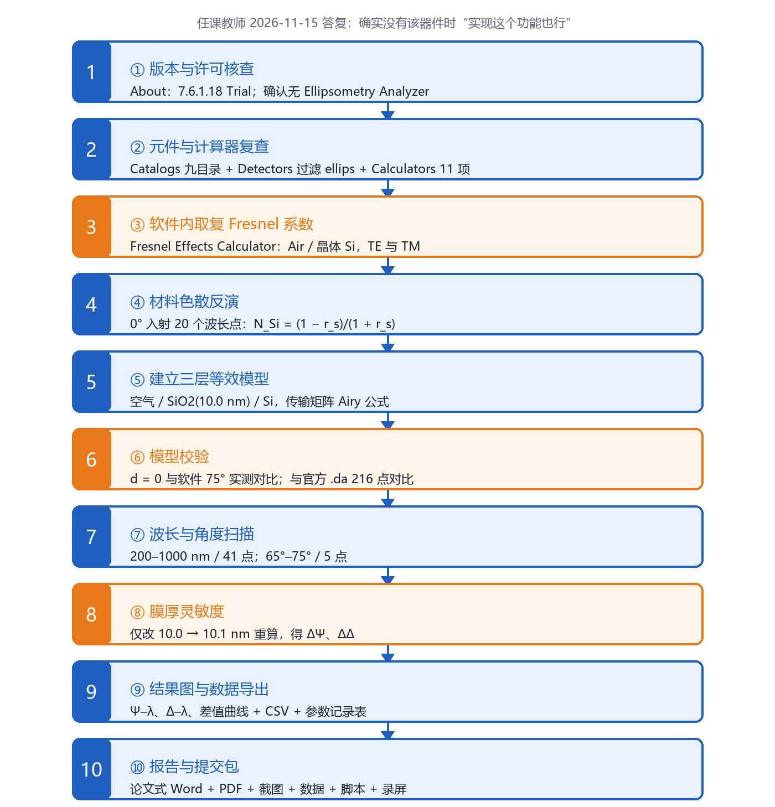

# 椭圆偏振测量的等效实现（VirtualLab 7.6 试用版）

题目原本要求用 VirtualLab 的 **Ellipsometry Analyzer** 测 SiO₂ 10 nm / Si 膜层。本机试用版 7.6.1.18 **没有这个分析器**（2023.1 才加入），经任课教师同意「实现这个功能即可」后，改用内置 **Fresnel Effects Calculator** 取 TE/TM 复 Fresnel 系数，按 $\rho=r_p/r_s=\tan\Psi\,e^{-\mathrm{i}\Delta}$ 等效完成椭偏测量：24 组软件读数 → 反演晶体 Si 的 n、k → 三层 Airy 模型算 Ψ、Δ → 与官方 216 点对照校验。

本目录是可复现部分：数据脚本、绘图脚本、截图采集工具、原始读数与结果 CSV、结果图与界面截图、口径文档。课程报告（Word/PDF）与录屏不入库。



## 亮点

- **等效路径可核**：读取 24 组复 Fresnel 系数（0° 入射 20 波长点、75° 入射 4 点），用 $r_s=(1-N)/(1+N)$ 反演 Si 的 n、k，再以官方 MISC.0096 的扩展 Cauchy 模型 + Airy 三层公式算 Ψ、Δ。
- **两级校验**：d = 0 时与软件 75° 实测振幅最大偏差 **6.6×10⁻⁴**；与官方 216 点（36 波长 × 6 角度）对照，max|ΔΨ| = **0.389°**、max|ΔΔ| = **0.197°**。
- **可分辨 1 Å**：10.0 nm 与 10.1 nm 膜厚差在 75° 引起 ΔΨ 0.030°–0.063°、ΔΔ −0.341°–0.151°。
- **限制有证据**：`docs/screenshots/` 17 张同一次会话截图（About 版本、Detectors 过滤 ellips 为空、Calculators 列表无椭偏项、Coatings 无 SiO₂ 模板），配合手册全文检索（ellipsometry 0 命中）。

## 目录

```
hw10-ellipsometry-equivalent/
├── src/build_data.py        读数 → 反演 n,k → Airy 模型 → 结果 CSV + 校验
├── src/draw_results.py      结果图（仅 Pillow）
├── tools/capture.py         界面截图采集（Windows，需 VirtualLab 在前台）
├── docs/principle.md        椭偏原理、ρ 约定、三层模型
├── docs/software-limits.md  试用版限制与证据、B′ 路径的由来
├── docs/data-notes.md       数据来源、两级校验、可复现步骤
├── docs/screenshots.md      17 张界面截图的逐张说明
├── docs/references.txt      参考文献清单（12 条）
├── docs/references-check.md 四条网络文献的链接核验记录
├── docs/manual-search-log.txt 安装目录与手册的全文检索日志
├── data/                    9 份 CSV（软件读数、反演 n,k、Ψ/Δ、厚度差、参数、官方 216 点）
├── docs/images/             8 张结果图 + 总览
└── docs/screenshots/        17 张界面截图（T01–T10c）
```

## 快速开始

```bash
cd hw10-ellipsometry-equivalent
pip install -r requirements.txt

# 1) 反演与建模（只依赖标准库）
python src/build_data.py
#   -> 写 7 份 CSV 到 data/，并打印：
#      official cross-check: max |dPsi| = 0.3893 deg, max |dDelta| = 0.1969 deg, n = 216

# 2) 画图（只依赖 Pillow）
python src/draw_results.py
#   -> docs/images/ 下 8 张结果图 + sheet.png
```

`tools/capture.py` 仅用于重采界面截图（`python tools/capture.py T05 700 430 1850 1090`），运行前须把 VirtualLab 窗口置于前台并保持位置不变；不重采时跳过。

## 文档

| 文件 | 内容 |
|---|---|
| [docs/principle.md](docs/principle.md) | ρ = r_p/r_s = tanΨ·e^{−iΔ}（即 Δ = −arg ρ）、三层 Airy 模型、Si 的 n,k 反演、Ψ/Δ 对膜厚的灵敏度 |
| [docs/software-limits.md](docs/software-limits.md) | 7.6.1.18 无 Ellipsometry Analyzer 的三条证据、试用版禁用保存、B′ 等效路径与教师口径 |
| [docs/data-notes.md](docs/data-notes.md) | 24 组读数的取法、两级校验、1 Å 灵敏度、官方 216 点 CSV 的来源与重跑方式 |
| [docs/screenshots.md](docs/screenshots.md) | 17 张界面截图的逐张内容与用途 |
| [docs/references-check.md](docs/references-check.md) | [3][4][6][9] 四条网络来源的状态码、内容类型与著录一致性 |
| [docs/references.txt](docs/references.txt) / [docs/manual-search-log.txt](docs/manual-search-log.txt) | 参考文献清单；安装目录与 889 页手册的全文检索日志 |

## 已知局限

- **不是专用椭偏仪**：等效路径只取复 Fresnel 系数，没有 Ψ/Δ 拟合、没有多角度多波长联合反演；膜厚由模型给定（10.0 / 10.1 nm），不是从 Ψ、Δ 拟合出来的。
- **膜层模型取自官方用例**：SiO₂ 用扩展 Cauchy（A=1.44，B=0.00422 µm²，C=1.89×10⁻⁵ µm⁴），不是本机实测色散。
- **Si 色散是反演值**：由 0° 入射 20 个波长点的复系数反演并分段线性插值，与厂商数据库可能有系统差。
- **截图与录屏是同一会话的凭证**：试用版每次启动消耗次数，重跑截图需要重新启动会话，界面状态无法逐位复现。
- **`build_final_report.py` 未入库**：它生成含封面/目录/学号的课程报告，属课程交付件。

## 说明

数据与文档用于学习交流，引用请注明出处；截图与结果图均为本人会话产物，不含第三方素材。
