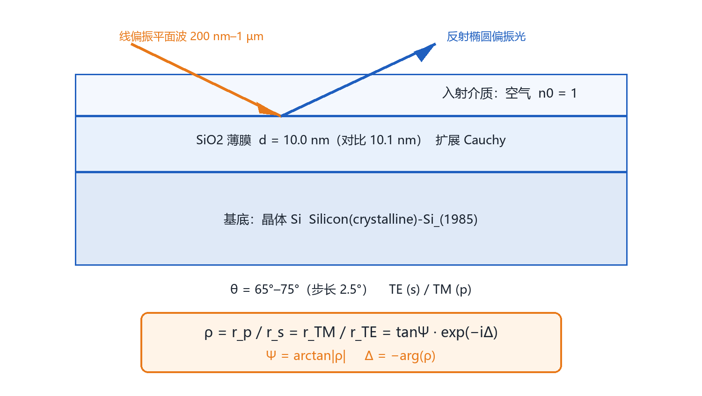
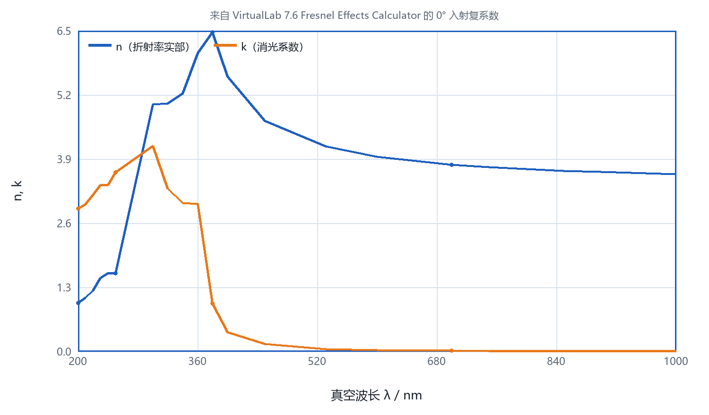
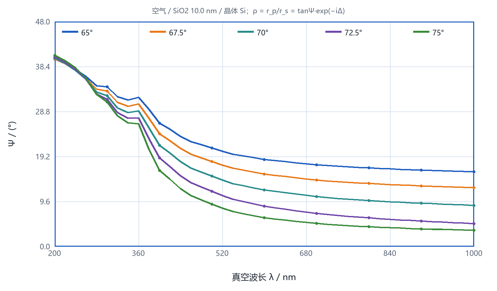
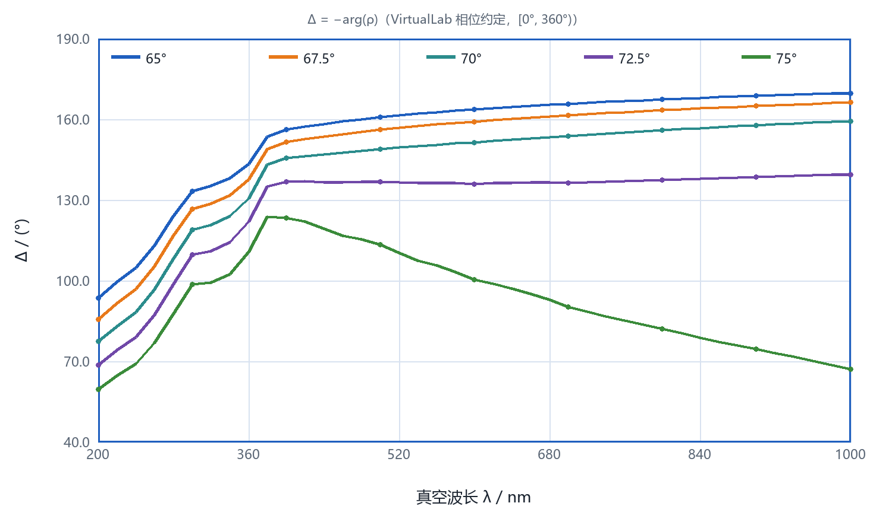
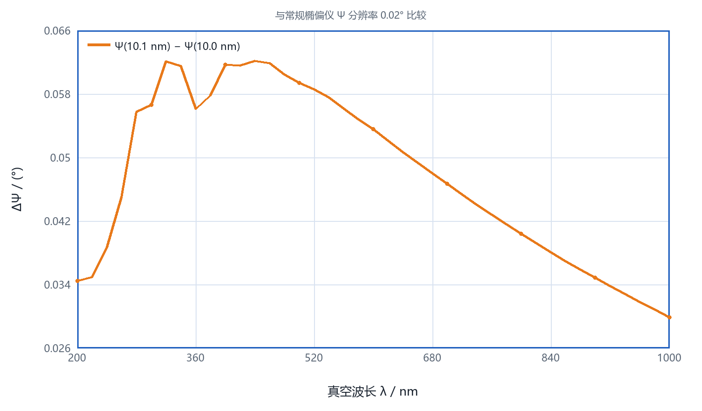
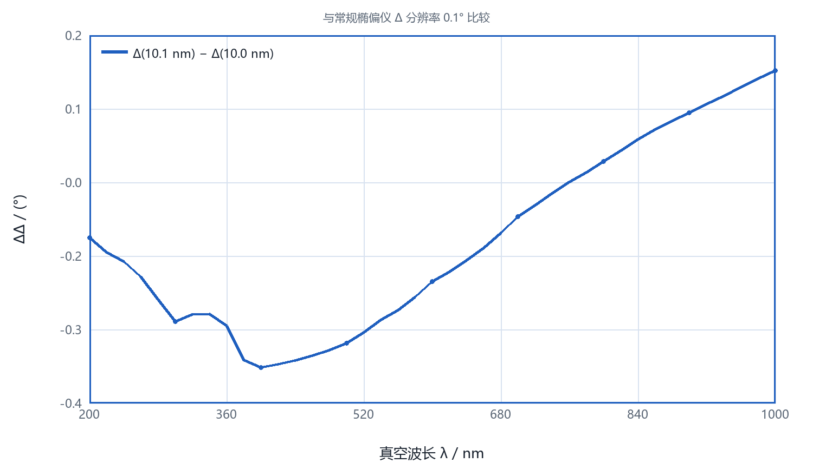
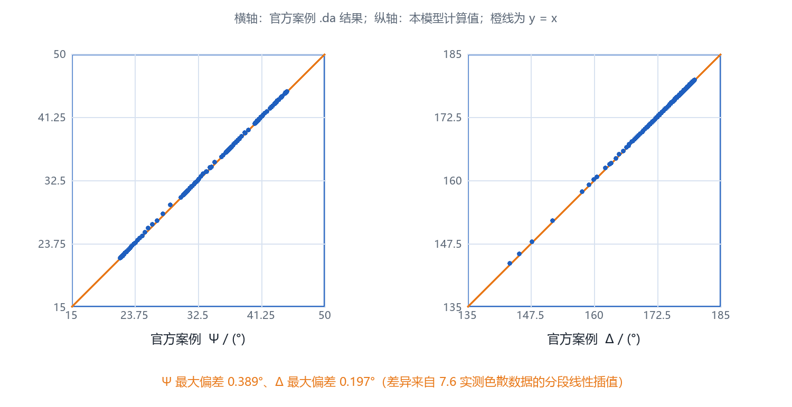

# 椭偏原理与这里用的等效模型

## 一、椭偏测量的基本关系

光在界面反射时，p（TM）与 s（TE）分量的复反射系数不同，其比值定义了椭偏参量：

$$
\rho\equiv\frac{r_p}{r_s}=\frac{r_\mathrm{TM}}{r_\mathrm{TE}}=\tan\Psi\,\mathrm{e}^{-\mathrm{i}\Delta}
$$

因此

$$
\Psi=\arctan|\rho|,\qquad \Delta=-\arg\rho
$$

**符号约定很重要**：`Δ = −arg ρ`（不是 `+arg ρ`）。本作业的约定由官方 MISC.0096 的 `.da` 结果标定——按此约定逐点对照时 Ψ 完全吻合、Δ 偏差 < 0.2°；若把指数写成 $\mathrm{e}^{+\mathrm{i}\Delta}$，Δ 符号会反。

Δ 取 `[0°, 360°)`，相位展开约定：0° 入射裸硅 Δ≈180°。

## 二、三层样品与 Airy 模型

样品：空气 / SiO₂ 膜 / 晶体 Si 基底。膜层折射率用官方 MISC.0096 的**扩展 Cauchy** 模型：

$$
n_\mathrm{SiO_2}(\lambda)=A+\frac{B}{\lambda^2}+\frac{C}{\lambda^4},\quad
A=1.44,\ B=0.00422\ \mu m^2,\ C=1.89\times10^{-5}\ \mu m^4
$$

三层用标准传输矩阵（Airy）求解，与 VirtualLab 的 Fresnel / Coating Analyzer 定义一致。d = 0 时退化为裸硅的 Fresnel 反射，用作第一级校验。

膜厚取 10.0 nm（基线）与 10.1 nm（对比，差 1 Å），对应题目与官方案例。

## 三、晶体 Si 的 n、k 反演

试用版没有椭偏分析器，也没有直接给出基底复折射率的入口，所以用软件自身在 **0° 入射**下的 TE 反射系数反演：

$$
r_s=\frac{1-N}{1+N}\ \Rightarrow\ N=\frac{1-r_s}{1+r_s},\qquad N=n-\mathrm{i}k
$$

0° 入射时 TE 与 TM 读数完全相同（软件表里可验证，例如 450 nm 处同为 0.64771·exp(−3.1277 rad·i)），因此这一路反演只依赖单一偏振读数，不受角度设置误差影响。20 个波长点（200–1000 nm）反演后分段线性插值得 $n(\lambda)$、$k(\lambda)$。

## 四、Ψ、Δ 与膜厚

10.0 nm 膜层在 65°–75°、200 nm–1 µm 范围内：Ψ 覆盖 3.457°–40.772°，Δ 覆盖 59.619°–169.702°。

1 Å 膜厚差（10.0 → 10.1 nm）在 75° 引起：

| 量 | 范围 |
|---|---|
| ΔΨ | 0.030°–0.063° |
| ΔΔ | −0.341°–0.151° |

这说明椭偏对亚纳米膜厚变化有响应，但也意味着 Ψ、Δ 的读数精度必须优于 0.03°/0.15° 才能分辨 1 Å——这正是专用椭偏仪要做多角度多波长联合拟合的原因。

## 五、两级校验

| 级别 | 做法 | 结果 |
|---|---|---|
| 第一级 | d = 0 退化，与软件自身 75° 实测振幅对照 | 最大偏差 **6.6×10⁻⁴** |
| 第二级 | 与官方 MISC.0096 的 216 点（36 波长 × 6 角度）Ψ、Δ 对照 | max\|ΔΨ\| = **0.389°**，max\|ΔΔ\| = **0.197°** |

第二级的残差主要来自 7.6 实测色散数据的分段线性插值。

