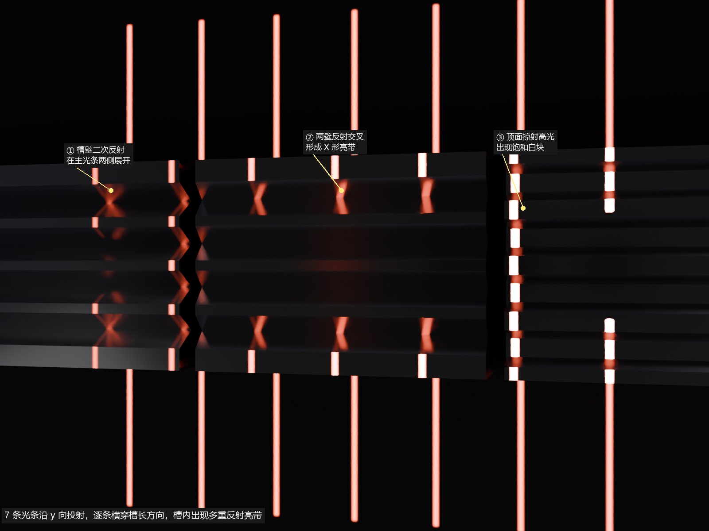

# 多线结构光测量系统（仿真 + 光条提取）

一套面向 2 m 级大尺寸构件的多线结构光测量系统：7 条 650 nm 激光线一次覆盖 1.5 m 测量带，工业相机与投射器同高安装（基线 1.5 m，工作距离 2.84 m）；在 Blender/Cycles 中做物理光路仿真，用于对比**哑光 / 高反光 / 透明**三种表面成像，并复现**沟槽内部互反射**这一典型失效场景；配套一个不依赖成像条件的**光条中心提取算法**。

本目录是这套工作的可复用部分：算法源码、仿真场景、审计与渲染脚本、参数文档。课程报告、录屏脚本与含学号的提交包不在库内。



## 亮点

- **仿真参数自洽**：相机 10 mm / 靶面 7.2 mm / 倾角 14.52°、7 条面光源 0.012×1.55 m / 0.004 rad，与设计计算逐项对应，`tools/blender_audit.py` 可一键核对。
- **互反射真做出来**：靠路径追踪自然产生多次弹射，并用 V60° / V90° / 梯形三种槽型做结构对比，而不是只改材质。
- **算法可复现**：同目录一条命令跑出 7/7 检出、剔除 2 个副峰，射影模型残差 1.11 px（相对 250 mm 线距 0.57%）。

## 目录

```
hw4-multi-line-structured-light/
├── src/line_center_extract.py     光条中心提取（S1—S6，CLI）
├── tools/blender_audit.py         场景参数审计
├── tools/render_camera.py         指定相机/帧/分辨率批量渲染
├── docs/                          系统设计、仿真说明、算法说明
├── data/groove_render.png         测试图像（1600×1200）
├── assets/multi_line_scene.blend  仿真场景（两场景、96 帧动画）
└── scripts/sync.ps1               从本地提交目录同步最新成果并提交
```

## 快速开始

```bash
cd hw4-multi-line-structured-light
pip install -r requirements.txt

# 1) 跑算法，结果写入 out/
python src/line_center_extract.py

# 2) 核对仿真参数（Blender 5.2）
blender -b assets/multi_line_scene.blend --python tools/blender_audit.py

# 3) 重渲示例图（第 48 帧）
blender -b assets/multi_line_scene.blend --python tools/render_camera.py -- \
    --scene 02_沟槽互反射 --cam T4_相机_12mm --frames 48 --out out/reflection.png
```

算法输出：

```
检出主光条：7 / 期望 7     剔除副峰：2
平均线距 193.41 px；自标定比例尺 1.2926 mm/px
原始间距 CV 6.96%；射影模型残差 RMS 1.11 px ≈ 1.44 mm（0.57%）
```

## 文档

| 文件 | 内容 |
|---|---|
| [docs/system-design.md](docs/system-design.md) | 光学几何、部件选型、最终指标、适用边界 |
| [docs/simulation.md](docs/simulation.md) | Cycles 设置、光源与材质参数、六个常见坑 |
| [docs/algorithm.md](docs/algorithm.md) | S1—S6 流程、射影先验的推导、结果与局限 |

## 已知局限 / 后续

- 比例尺目前由设计线距**自标定**（相对尺度）；下一步接入相机内参与光平面标定，把候选峰反投影求交，得到绝对坐标。
- 单帧验证；多帧拼接与运动误差补偿尚未做。
- 高反光与透明件的处理只有定性对比，未做偏振/多曝光的定量实验。

## 说明

代码与文档用于学习交流，引用请注明出处；`.blend` 内不含第三方资产。若用于课程或论文，请自行核对所在单位的要求。
