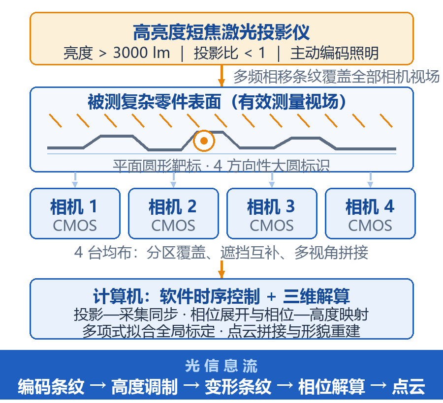

# 机器视觉检测系统构建与主动光学三维测量方法调研

《仪器光学设计》作业 5 的文献调研：第 1 小题调研一款系统（天津大学公开专利 **CN110793464B**「大视场条纹投影视觉三维测量系统」），第 2 小题比较**结构光/条纹投影（FPP）**、**条纹偏折/相位测量偏折（PMD）** 与**光度立体（PS）** 的原理、区别与应用。

两个小题用同一条主线串起来：机器视觉检测按**光信息流**理解（照明写入光场 → 被测面调制 → 成像保真传递 → 算法反演），三法的差别本质上是**被测面满足哪种光学条件**，由此决定观测量分别是绝对高度、表面梯度、表面法线。

## 内容

| 文件 | 内容 |
|---|---|
| [docs/survey-system.md](docs/survey-system.md) | 第 1 小题：系统总体结构与光信息流、光源布局（含投影比与照度的定量反推）、相机与镜头参数（三条选型公式与算例）、标定与同步、七步开发闭环与课程六阶段对照、误差预算 |
| [docs/survey-methods.md](docs/survey-methods.md) | 第 2 小题：FPP / PMD / PS 的链路与边界、成像链路对照、七维度对比表、按表面属性分层的选型决策、应用场景与国内研究现状 |
| [docs/references.md](docs/references.md) | 31 条 GB/T 7714 著录 + 引用注意（专利法律状态、厂商资料与期刊的分工） |
| [docs/review-log.md](docs/review-log.md) | 一轮外部审读引出的六类问题与修订做法，以及引用核验的可复用习惯 |
| [docs/images/](docs/images/) | 图 1 系统布局、图 2 七步闭环、图 3 三法成像链路、图 4 选型决策树（按公开资料重绘） |

## 几处值得记住的结论

- **光源布局不是「选哪种打光」，而是空间约束**：专利用三条硬指标（>3000 lm、投影比 <1、条纹覆盖全部相机视场）限定投影仪位置，反过来约束四相机的分区与单相机视场（约 0.83 m）。
- **相机参数要分清「查到的」与「算出来的」**：该专利未公开任何相机型号与参数，文中给出的是通行区间与按指标反推的算例——单相机视场 0.83 m、0.2 mm 缺陷、3 像素覆盖，需约 1.25 万水平像素，超出常规面阵经济区间，这正是大视场要用多相机分区的原因。
- **对比度的优先级高于分辨率**：像素数买的是采样密度，检出率却取决于缺陷与背景的对比度——同一条 0.03 mm 划痕在明场只有 0.26 灰阶差，换暗场掠射可差到 255 灰阶。
- **三法的分界是被测面**：镜面/类镜面 → PMD；漫反射且需绝对高度 → FPP；哑光浅划痕且要滤掉颜色纹理 → PS。三者都不适用时，该改的是检测需求，不是方法。
- **PMD 的两个硬限制**：只测镜面（漫反射粗面不成像）、只给梯度（单相机存在高度—斜率歧义，须双目/移动屏/SCOTS/辅助测距提供基准）。

## 说明

这是一篇文献调研：没有搭建实物系统，也没有运行仿真，文中不出现仿真界面与仿真结果；插图按公开专利、期刊论文与行业资料重绘，算例按公开公式计算，凡属本文设定的假设（如 1.5 m×1.1 m 视场、20% 重叠、2×2 分区）都在文中以「若…计」「按…」标注。课程报告 docx/pdf 属课程交付件，不入库。
