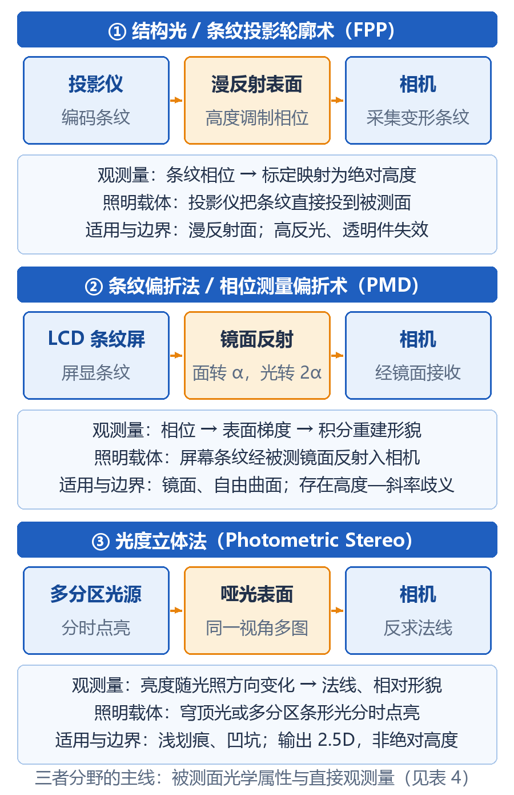
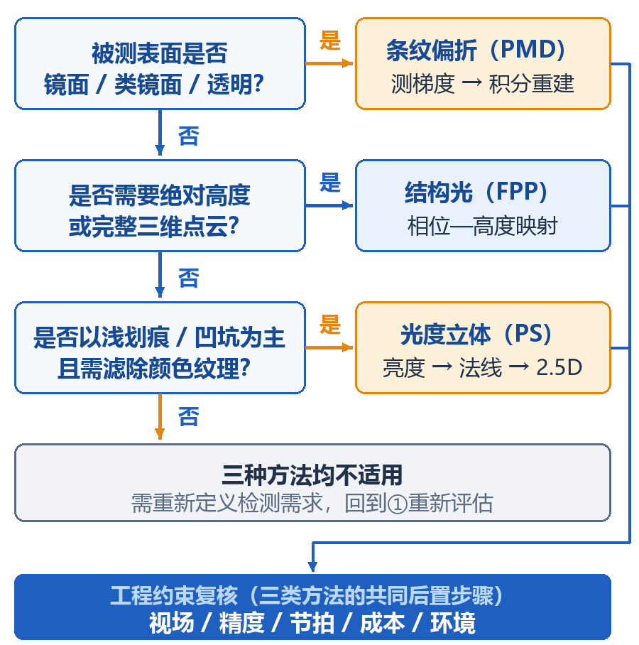

# 第 2 小题：三类主动光学形貌测量方法

> 系统实例与开发流程见 [survey-system.md](survey-system.md)，文献见 [references.md](references.md)。

## 4 三类主动光学形貌测量方法原理

### 4.1 结构光 / 条纹投影轮廓术（FPP）

结构光三维测量的基本链路是：投影仪（LCD、DLP-DMD，或用激光、LED 直投图案）把编码条纹投到被测表面，表面高度调制条纹相位，相机采集变形条纹，解码相位后按系统标定模型换算成高度或三维点云[18][2]。系统结构可以是单投影仪单相机、单投影仪双相机、单投影仪多相机，也可以是单相机双投影仪或多投影仪；编码策略分单次投影（彩色编码、灰度索引、几何形状编码、随机斑点）和多次投影（二进制编码、多频相移、格雷码加相移混合编码）[2]。直接观测量是相位，经相位展开和相位—高度映射得到绝对高度，输出的是可任意旋转、可直接量尺寸的绝对点云，代价是必须做系统标定与相位展开。

这一方法主要用于漫反射的工业表面。高反光件会饱和并产生互反射，透明件会出现透射与寄生条纹，运动件则因多帧采集而失配[2][5]；互反射引起的亮度叠加和伪光条在投影类系统里相当普遍，已有研究用互反射先验生成掩膜来补偿[19]。四川大学团队的综述把复杂场景归纳为大尺寸场景、高动态范围工件、高速运动过程和大口径光滑光学元件四类，并指出条纹投影与条纹反射分别对应漫反射和镜面两条技术路线[18]。第 2 章的专利群[4][11-14] 和焊膏三维测量的工作[20] 都属于这一路线。

结构光还有一条工程路线是多线结构光，一次投射多个光平面，省去机械扫描、点云获取更快，代价是各光平面的位姿必须统一标定。邹易用可自由移动的平面棋盘格靶标完成单光面标定，再靠旋转矩阵把两个已标定的光面推广到任意光面的位姿求解，并对光条编码以确定它属于哪个光面[21]；吴芳搭建了多线结构光系统，完成标定与点云获取实验并给出精度分析[22]。两项工作都把难点落在「光面统一标定加光条编码」上，而不是投影器件本身，这与第 2 章专利群中全局统一校准的思路相同[14]；课程大作业《多线激光测量系统》之所以把高反光沟槽的互反射单列出来，原因也在这里[1]。

### 4.2 条纹偏折法 / 相位测量偏折术（PMD）

条纹偏折法不把条纹投到被测面上，而是显示在 LCD 屏或散射屏上，相机经被测镜面反射后接收条纹。表面斜率一变化，反射光就偏转，条纹相位随之改变，解出的相位给出的是表面梯度，积分之后才能重建形貌[18][23]。由反射定律，待测表面相对参考平面转动 α 角时，反射光线转动 2α 角[18]，所以 PMD 对梯度特别灵敏；文献给出的相位—梯度关系为 $g_x=\tan\alpha\approx\Phi_{AB}/(4\pi fL)$，积分关系为 $z(x,y)=\int g_x\,dx+g_y\,dy+C$ [18][24]。陶迁等用 LCD 屏配合格雷码与相移条纹，单目相机加 Canny 边缘提取，在低而恒定的环境亮度下做到 0.1 mm 级的反射表面缺陷检测[25]。

PMD 擅长的是镜面、类镜面、抛光金属、汽车漆面和光学自由曲面[2-3]。与干涉测量相比，它系统简单、动态范围大，对振动和温漂不敏感，也能测自由曲面[26][23]；张祥朝、徐敏结合单点金刚石切削机床设计的在位偏折系统，精度优于 150 nm RMS[26]。限制也很清楚：漫反射粗面形不成镜面反射，测不了；得到的是梯度而不是绝对高度，单相机还存在高度与斜率的歧义，需要双目相机、移动屏幕、透射反射双屏幕、SCOTS 名义面形或辅助的激光与触觉测量来提供高度基准[23]；积分重构本身也会带来欠定性和累积误差[23]。透明件虽然可测，但前后表面的寄生反射会产生幽灵条纹，要靠算法或结构抑制[23]。

### 4.3 光度立体法（Photometric Stereo）

光度立体法把相机和被测物都固定住，让多个方位的光源（穹顶光、4 或 8 分区条形光等）依次点亮，同步采集同一视角下的多幅图像，由明暗随光照方向的变化反求表面法线和相对形貌[3][27]。常规成像只记录亮度，它记录的是亮度对光照方向的响应，因此能把反照率（颜色、印刷纹理）与几何（法向）分开，背景纹理的干扰也就被滤掉了，速度快、成本低[27]。它的输出属于 2.5D，给出的是表面相对高度变化和微小形貌，不是可任意旋转的绝对三维模型[3]；被测面一旦变成镜面或透明，反射模型不再成立，只能改用相位偏折[3]。

### 4.4 成像链路对照

三类方法的成像链路对照见图 3。三种方案都要「主动照明加相机」，但照明载体不一样：FPP 由投影仪把条纹投到物体上，PMD 的条纹在屏上、经镜面反射才进入相机，光度立体则是多分区光源分时点亮。光路经过被测面的方式、相机直接观测的物理量也随之不同。

三者的差别首先在照明载体与光路。FPP 由投影仪把编码条纹直接投到被测面，光只落地一次；PMD 的条纹在屏上，光经被测面反射后才进入相机，被测面参与的是反射而不是漫反射；光度立体没有条纹，只有方位不同的均匀照明，测的是同一视角下亮度随光照方向的变化。由此决定了两件事：一是直接观测量与所依赖的反射模型——FPP 解相位、经标定映射得绝对高度，前提是表面近似朗伯；PMD 解相位、经反射定律得梯度，前提是表面近似镜面；光度立体由亮度反求法线，前提是表面为已知模型的哑光面。二是各自不可替代的边界——FPP 遇高反光与透明件失效，PMD 对粗糙漫反射面无法成像，光度立体遇镜面则反射模型不成立。可见取舍得看被测面能满足哪种光学条件，而不看精度高低，5.2 节的决策树正是按表面属性分层的（光度立体输出为 2.5D 相对形貌，本文统称形貌测量）。

## 5 方法对比与选型依据

### 5.1 多维度对比

表 4 从被测面属性、直接观测量、照明载体、输出量、标定对象、主要误差源和典型应用七个方面对三类方法作横向比较。

**表 4 结构光、条纹偏折与光度立体的多维度对比**

| 维度 | 结构光 FPP | 条纹偏折 PMD | 光度立体 PS |
|---|---|---|---|
| 被测面 | 漫反射 | 镜面 / 类镜面 | 哑光漫反射 |
| 观测量 | 相位→高度 | 相位→梯度 | 亮度→法线 |
| 照明载体 | 投影仪 | LCD 条纹屏 | 多分区光源 |
| 输出 | 绝对三维点云 | 梯度积分形貌 | 2.5D 相对形貌 |
| 标定对象 | 相位—高度映射 | 屏 / 相机 / 镜面几何 | 光源方向与反射模型 |
| 主要误差 | 相位展开、高反光 | 高度—斜率歧义 | 非朗伯反射 |
| 典型应用 | 复杂零件尺寸 | 玻璃 / 漆面 / 曲面 | 浅划痕 / 凹坑 |

### 5.2 分层选型决策流程

选型可以整理成分层决策流程，如图 4 所示。先看被测面是不是镜面、类镜面或透明：是，则走 PMD 路线，同时复核高度—斜率歧义和寄生反射；不是，则进入漫反射分支，再看是否必须获得绝对高度或完整三维点云，需要就选结构光 FPP。若只需检出浅划痕、凹坑这类微小形貌，又希望抑制颜色纹理的干扰，光度立体在硬件成本和节拍上更划算。三者都不适用，说明检测需求本身要重新定义，换方法解决不了。三条支路最终统一进入视场、精度、节拍、成本与环境的工程约束复核。

### 5.3 讨论：第 1 小题选型的合理性

第 1 小题选结构光是有理由的：复杂零件表面以漫反射为主，检测目标是几何尺寸和三维形貌，既要绝对高度又要可拼接的完整点云，还要求大视场在线检测。CN110793464B 的做法是一台短焦高亮投影仪配四台均布 CMOS 相机，加上平面圆形靶标和软件时序同步，这些配置都是冲着上述需求去的[4]。若被测件换成手机玻璃盖板或汽车漆面，结构光会因镜面反射失效，按图 4 应走左支的 PMD；若换成带印刷纹理的锂电池外壳、只查浅划痕，右支末端的光度立体更合适。同一棵决策树能覆盖不同工件，也说明两个小题本来就照应着同一套问题。

## 6 应用场景与国内研究现状

### 6.1 应用场景

第 1 小题的系统，应用场景大致有三类。一是智能制造中复杂零件的几何尺寸与三维形貌在线检测，对象多为漫反射的金属件、铸件和注塑件[28]；二是需要单站覆盖较大工件或整条产线的场合，如白车身、大型结构件的装配间隙与面差测量，这时四相机分区拼接比单相机提高分辨率更有价值[28]；三是电子装配与半导体制程中的三维检测，如焊膏体积测量、FPD 制程与大尺寸玻璃检测[9][10][20]。三类场景的前提相同：被测面漫反射、需要绝对高度、要求在线节拍。

三类方法的应用则按表面属性分工。结构光 FPP 覆盖上述漫反射件的尺寸与形貌测量；条纹偏折 PMD 面向镜面与类镜面对象，如手机玻璃盖板、汽车漆面、抛光模具和光学自由曲面的面形与缺陷检测[25][26]；光度立体适合哑光外观件的 2.5D 检测，如锂电池外壳、手机中框、连接器和注塑件的浅划痕、凹坑、压伤，硬件简单、节拍快，可用于产线全检[3][27]。此外，机器人抓取与码垛拆垛[2]、航空航天的大范围位姿测量与自动化装配[28]也大量使用视觉三维测量。课程大作业《多线激光测量系统》里讨论的高反光、漫反射与透明材质的成像差异，以及高反光沟槽的互反射，与这里的方法选型是同一回事[1]。

### 6.2 国内研究现状

国内相关研究已经连成较完整的技术链。天津大学精仪学院「激光及光电测量」课题组长期做机器视觉几何量测量、空间位姿测量和微振动测试分析，代表性成果有多传感器融合的表面三维形貌快速测量、产品几何尺寸及缺陷在线识别检测系统等[28]；除第 2 章的专利群外，还公开了高速扫描整体成像三维测量方法（CN102589476B，一字线激光器、旋转多面棱镜加面阵 CCD）[29]。期刊论文方面，该组在条纹投影标定[17]、相位展开[15]、焊膏三维测量[20]、相机与闪光 LiDAR 联合标定[30]、畸变校正[16] 等方向上都有发表。

其他团队的工作补上了方法学的另一半。四川大学团队围绕条纹结构光照明的复杂场景三维测量作了系统综述[18]，并就沉浸式投影中的互反射补偿提出端到端方法[19]；深圳大学与上海工程技术大学分别以学位论文的形式给出多线结构光的光面快速标定[21] 与系统集成应用[22]；复旦大学与河北工业大学团队在光学自由曲面的在位偏折测量[26]、偏折测量技术的原理与挑战[23] 上做了面向精密制造的讨论；反射表面缺陷检测[25] 与基于平均曲率的偏折缺陷检测[24] 则是 PMD 在缺陷检测方向的细化。产业侧，埃科光电等国内厂商已能提供 16K 级制冷 TDI 线扫相机[9]，相机、镜头与光源环节的供应商还有 Basler、海康机器人、大恒图像、Computar、Schneider、CCS 和奥普特 OPT 等[7][31]。综合来看，国内在编码、标定、相位解算到系统集成的链条上积累较厚，难点正从理想漫反射件转向高反光、半透明和高速运动这些复杂场景。

## 7 总结与展望

从这次调研可以得出三点。第一，机器视觉检测系统宜沿光信息流去理解，而不是按部件清单罗列：照明或投影负责把信息写入光场，被测面完成调制，成像与探测负责保真传递，算法负责反演，光源布局、相机参数和开发流程都只是这条链路在各环节的展开。第二，第 1 小题选的大视场条纹投影系统，关键做法是用高亮短焦投影覆盖多相机视场、用四相机均布加全局标定换取大视场下的精度、用软件时序同步保证多帧采集一致，课程六阶段流程与六条设计准则都能与之对应。第三，结构光、条纹偏折和光度立体的差别不在硬件形态，而在被测面光学属性与直接观测量，绝对高度、表面梯度、表面法线分别对应三类输出，选型应先判表面，再判是否需要绝对高度。

后续值得关注的方向有三个：一是复杂场景下的建模，把多次反射、次表面散射和阴影遮挡纳入观测模型，从几何三角测量扩展到考虑光传播过程的计算三维成像；二是高动态范围与高速测量，用多次曝光、单帧编码等办法缓解过曝和运动失配；三是标定与数据链的智能化，包括深度学习辅助的相位展开、在线自标定和多传感器融合。对这门课来说，如果能把光信息流这条线索一直用在部件选型、仿真和结果分析上，比单独记器件参数更容易把仪器的设计思路串起来。
