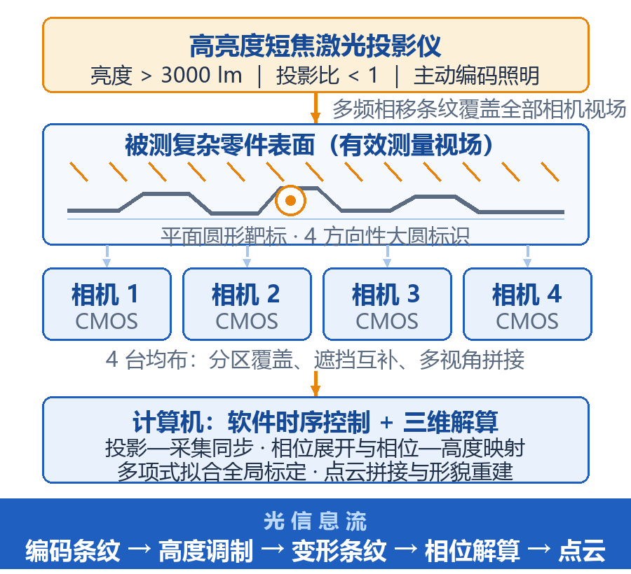
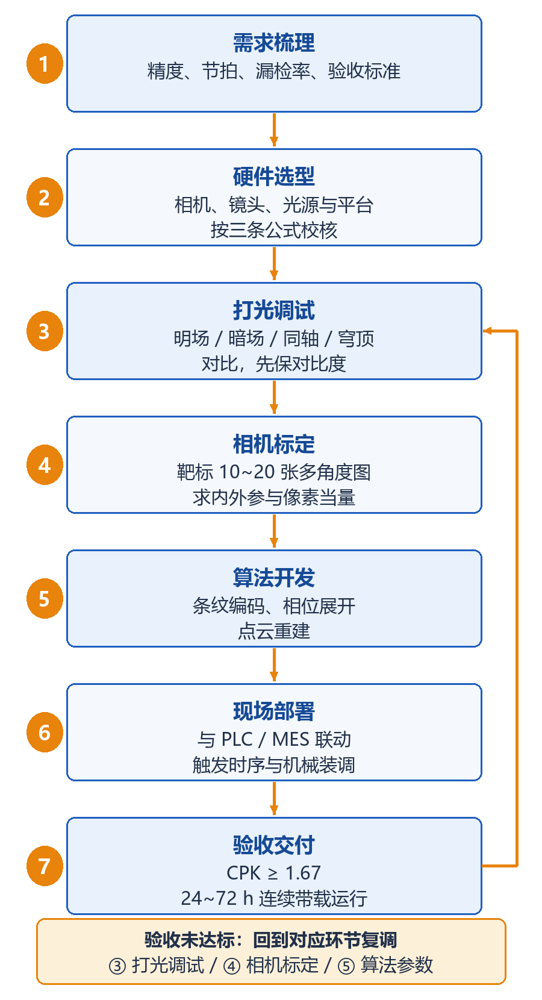

# 第 1 小题：机器视觉检测系统构建（以大视场条纹投影系统为例）

> 本文是《仪器光学设计》作业5 第 1 小题的调研成果，方法学部分见 [survey-methods.md](survey-methods.md)，文献见 [references.md](references.md)。

## 1 引言

仪器光学设计关心的是光信息在仪器中如何产生、变换和接收，而不只是某一个光学元件的参数。课程讲义把仪器光学系统分为视觉、投影、光谱与特殊光学原理四类，其中视觉光学系统以工业相机、显微镜为代表，用于缺陷检测和尺寸测量；投影光学系统包括结构光、AR-HUD 等，任务是把编码信息写入光场[1]。机器视觉检测系统正好同时用上这两类系统：照明或投影单元把携带信息的光场投向被测面，被测面的几何形状与反射特性对光场进行调制，成像物镜把调制后的光场送到探测器，算法再由图像反推出被测量。光源、光束调整、被测面、成像、探测、处理这六个环节串成的链路，就是课程所说的光信息流[1]。

传统二维视觉靠灰度与纹理判断有无、对齐和尺寸，成像对比度决定了它能做到什么程度。智能制造中，复杂零件的三维形貌、装配间隙、焊膏体积和表面微缺陷都需要深度信息，检测对象因而从 2D 扩展到 2.5D 和 3D[2-3]。被测面的光学属性也就成了方法选型的第一个约束：漫反射件可以直接投射编码图案并解调相位；镜面、类镜面或透明件会让投射光过曝、透射或产生寄生反射，只能改用基于反射定律的条纹偏折；以浅划痕、凹坑为主又带印刷纹理的外观件，则适合用多方向照明的光度立体法把几何与颜色纹理分开[3]。三类表面不可能用同一套硬件覆盖，这是第 2 小题要讨论方法对比的原因。

本文的安排是：第 2、3 章调研大视场条纹投影视觉三维测量系统，逐项回答光源布局、相机参数、开发流程和应用场景；第 4、5 章比较三种主动光学测量方法的原理与区别，第 6 章再合起来谈应用与国内研究现状。这是一篇文献调研，没有搭建实物系统，也没有运行软件仿真，因此文中不出现仿真界面和仿真结果；系统图、流程图、原理图与决策树均按公开专利、期刊论文和行业资料重绘，算例按公开的选型公式计算。

## 2 大视场条纹投影三维测量系统

### 2.1 系统总体结构与光信息流

第 1 小题的调研对象取天津大学公开的发明专利 CN110793464B《大视场条纹投影视觉三维测量系统和方法》（王鹏、张颖杰、孙长库，2019-10-17 申请，2021-08-20 授权）[4]。该方案由高亮度短焦激光投影仪、4 个互补金属氧化物半导体（CMOS）工业相机、计算机和靶标组成。专利摘要给出的三项规定是：投影仪亮度大于 3000 lm、投影比小于 1，所投条纹须覆盖所有相机的有效测量范围；4 个相机均匀分布于整个视场，采集范围合起来覆盖整个视场；投影与采集由软件时序控制同步[4]。该专利因未缴年费已于 2024-07-02 终止，此处仅作为公开的技术方案文献引用。

按课程分类，投影端属投影光学系统，成像端属视觉光学系统，两者通过被测面耦合起来。承第 1 节所述光信息流，本系统在五个环节上的对应部件依次为：投影仪完成编码照明，被测表面发生高度调制，4 台相机采集变形条纹，相位解算与多项式拟合标定完成相位到高度的映射，点云拼接后输出三维形貌。系统结构、四台相机的视场分区与光信息流见图 1，主要部件的性能与功能参数列于表 1。

**表 1 系统主要部件及性能 / 功能参数**

| 部件 | 规格 / 配置 | 关键性能与功能 |
|---|---|---|
| 投影单元 | 高亮度短焦激光投影仪 | >3000 lm，投影比<1；条纹覆盖全部相机有效测量范围 |
| 成像单元 | 4 台 CMOS 工业相机 | 均布整个视场；分区覆盖、遮挡互补与点云拼接 |
| 标定靶标 | 平面圆形靶标 + 4 个大圆标识 | 圆形尺寸/圆心距加工误差 ≤0.2 mm，平面度 ≤1 mm |
| 同步控制 | 计算机软件时序控制 | 投影—采集同步；多项式拟合全局标定与三维点云解算 |

注：该专利未公开具体型号，本表按方案规定与本文归纳整理。

### 2.2 光源布局与主动照明

常规二维视觉检测里，照明的任务只是让目标特征与背景拉开灰度差。条纹投影系统不同，光源同时是照明装置和信息载体：它投射纵横两个方向的多频相移条纹，相位解调与全局标定都依赖这些编码[4]，因此专利选择高亮度短焦激光投影仪，并用亮度与投影比两项指标来约束布局。

专利没有给出投影仪与相机的相对角度，但三条硬约束已把空间关系限定得很紧：投影仪亮度大于 3000 lm、投影比小于 1，且所投条纹须覆盖全部相机的有效测量范围，4 台相机又须均匀分布于整个视场。投影比 r 定义为工作距离 WD 与画面覆盖宽度 W 之比，r<1 意味着覆盖宽度大于工作距离，投影仪只有退到视场之外、以较小入射角斜投，才能在有限工作距离内一次覆盖四台相机的视场。亮度要求则是对大覆盖面积下照度衰减的补偿：若总视场按 1.5 m×1.1 m 计，3000 lm 均匀分布约合 1.8×10³ lx，才撑得起微秒级短曝光下的信噪比。覆盖要求还反过来约束相机分区——四台相机按 2×2 分区、相邻视场重叠 20% 时，1.5 m 的总视场对应单相机视场约 0.83 m，这个数直接决定 2.3 节的分辨率需求。

表 2 汇总了七种典型打光方式的适用对象与失效边界，可作为判断本系统为何选主动投影而非常规照明的对照依据（结构光属投影测量体制，见 4.1 节，未列入表中）。

**表 2 七种典型照明方式的适用对象与失效边界**

| 照明方式 | 适用对象 | 失效边界 |
|---|---|---|
| 明场（>45°） | 平面、哑光、轻纹理 | 抛光 / 镜面眩光 |
| 暗场（15°~45°） | 划痕、毛刺、凸起凹坑 | 曲面件、位置跳动 |
| 背光（透射） | 轮廓尺寸、透明件内部缺陷 | 不透明件表面缺陷 |
| 同轴 | 镜面、抛光金属、硅片 | 大面积曲面、深腔 |
| 穹顶 / 无影 | 曲面、高反光件整体外观 | 需方向性对比的细微缺陷 |
| 偏振 | 压制镜面反光 | 非双折射材料效果有限 |
| 条形 / 环形 | 大面积方向性对比 | 对微小缺陷灵敏度低 |

以上分类与失效边界据文献[5][6]整理。表 2 里各方式的失效边界指向同一个工程判据：分辨率和对比度是两件事，像素数决定采样密度，检出率却取决于缺陷与背景的对比度[5]。同一条微细划痕在明场下几乎没有灰度差异，容易被噪声底淹没；换成低角度暗场掠射后，划痕的散射光明显强于周围表面，对比度可以提高一个数量级以上。所以实际操作中应先靠打光把对比度做出来，再按精度要求决定要不要升级相机。

波长的选择同样由材质决定。可见光用于常规检测，红外能穿透部分半透明材料，紫外用于荧光激发和微小缺陷增强[6]。红光穿透性强，蓝光散射更强、衍射极限更小，因而更适合微细表面缺陷；不过对高反光金属该用红光还是蓝光，查到的资料结论相反，这里只按「波长与材质的反射、散射特性匹配」来理解，不作定论。

### 2.3 相机与镜头参数

专利对相机只公开了「4 台 CMOS 相机均匀分布于整个视场」这一句，分辨率、像元尺寸、帧率和镜头参数都没有给出，本节的数值取自工程通行区间，或按 2.2 节的覆盖要求反推，不是该系统的实测参数。四台相机均布有三个用意：分区覆盖以换取大视场，多视角互补以减少遮挡和阴影，重叠区域还可用于点云拼接和全局统一标定[4]。

器件选型要定的参数包括分辨率、帧率、像元尺寸、靶面尺寸、快门类型、数据接口与镜头形式。常见区间是分辨率 200 万~2000 万像素、像元 2.4~10 μm、靶面 1/3″~全画幅，静态检测 10~30 fps，高速检测可到 500 fps 以上；CCD 噪声低、像质好，CMOS 速度快、成本低、功耗小；拍运动件要用全局快门避免拖影；接口则有 GigE Vision、USB3 Vision、Camera Link 和 CoaXPress 几种[6][7]。镜头分定焦、远心和变焦，远心镜头能消除物距变化带来的放大倍率误差，焦距、F 值、景深、工作距离和靶面尺寸要一起校核[6]。把 2.2 节反推的单相机视场 0.83 m、0.2 mm 缺陷、单特征 3 像素代入，水平像素需约 1.25 万，已超出常规面阵器件的经济区间，这也是大视场方案要用多相机分区换取分辨率的原因。

三条选型公式及算例列于表 3。分辨率按所需水平像素数 = 视场宽度 ÷（最小缺陷尺寸 ÷ 单特征覆盖像素数）计算，工程上单特征取 3~5 像素（Nyquist 至少 2 像素）；FOV 100 mm、缺陷 0.2 mm、按 3 像素覆盖时像素当量为 0.0667 mm/px，约需 1500 px。帧率应不小于产线速度 v 与单帧有效视野长度 L 之比，再乘 1.1~1.2 的重叠与安全系数，同时曝光时间须满足 t_exp ≤ 像素当量 / v 以抑制运动模糊；v = 500 mm/s、L = 50 mm 时理论值 10 fps，取 11~12 fps。焦距由 FOV =（传感器靶面宽度 × WD）/ f 得到 f =（SensorSize × WD）/ FOV；靶面宽 7.2 mm、WD 300 mm、FOV 100 mm 时 f = 21.6 mm，选 20 或 25 mm 定焦镜头即可[8]。有些资料写作「帧率 ≥ 运动速度 ÷ 检测精度」，这个式子的量纲并不成立，核算时应以上式的算法为准。

**表 3 相机与镜头选型的三条公式及算例**

| 项目 | 计算式 | 算例 |
|---|---|---|
| 分辨率 | N = FOV ÷ (d_min ÷ 3~5)，N 为水平像素数 | FOV 100 mm、d 0.2 mm、3 像素覆盖 → 0.0667 mm/px，约 1500 px |
| 帧率 | fps ≥ v / L；t_exp ≤ 像素当量 / v | v 500 mm/s、L 50 mm → 10 fps，取 11~12 fps |
| 焦距 | f =（SensorSize × WD）/ FOV | 7.2 mm、300 mm、100 mm → 21.6 mm，选 20 / 25 mm |

器件层面可以举一个行频、分辨率与接口必须一起看的例子：埃科光电 TPH16KCXP12-250KT 是 16384×256 像元、像元 5 μm、光学尺寸 81.92 mm 的制冷 TDI 线扫相机，8 bit 行频在 2023 年展会资料中为 250 kHz，厂商现行页面已提到 280.9 kHz，接口为 CoaXPress12[9][10]。它面向 FPD 制程和大尺寸玻璃检测，与本文的面阵四相机方案不是一类用法，这里只是作为旁证。

### 2.4 标定、同步与设计准则

大视场多相机方案能否成立，很大程度上取决于全局标定。该专利用平面圆形靶标，靶上设 4 个方向性大圆标识，要求圆形尺寸与圆心距的加工误差不超过 0.2 mm、靶标平面度不超过 1 mm，再借纵横两个方向的多频相移条纹和多项式拟合完成全局标定[4]。同一课题组在编码、标定与相位映射三个环节上还公开了四项专利：相位—高度转换映射模型及其标定方法（CN107610183B）[11]、基于时域空域混合编码的条纹投射方法（CN106643562B）[12]、按投射条纹几何分布特征的系统标定方法（CN106595517B）[13]，以及用立体靶标对线结构光轮廓传感器作全局统一校准的方法（CN104567727B）[14]。

对照课程第一章的六条设计准则，这套方案的取舍大体有迹可循。系统只用一台投影仪加四台相机，符合最小化光学元件数量的要求；靶标加工误差与平面度指标，是最大化允许公差在装调环节的落地；四相机均布对应元件放置原则；用多项式拟合做全局标定而不是逐点标定，对应全局优化思想；相机内参、畸变与成像质量的评价则属像质评价方法的选择。六条准则中的最小化曲率半径主要约束成像物镜的面型，在本系统里表现为镜头选型与像差校核[1]。

## 3 系统开发流程

### 3.1 七步闭环与课程六阶段的对应

工程上机器视觉检测系统的落地通常按七步闭环推进，如图 2 所示。①需求梳理：把精度、节拍、漏检与误检率、环境条件和验收标准量化。②硬件选型：定下相机、镜头、光源、投影与计算平台，按表 3 的三条公式校核。③打光调试：比较几套照明方案，先把对比度做出来。④相机标定：用棋盘格或立体靶标采集 10~20 张不同角度的图像，求内外参、畸变校正与像素当量。⑤算法开发：完成条纹编码、相位解调与展开、点云重建，可选 OpenCV、Halcon 或深度学习。⑥现场部署：与 PLC/MES 联动，确定通信协议、触发时序，完成机械装调。⑦验收交付：做精度、速度与稳定性的带载测试，过程能力指数一般要求 CPK ≥ 1.67，并连续带载运行 24~72 h。哪一步没达标，就回到打光、标定或算法参数上复调，闭环由此形成。

课程讲义给出的光机设计六阶段是：需求分析与技术指标设定、外形尺寸计算（一阶设计）、初始结构选择与计算、像差校正与性能优化、公差分析与性能评估、光机集成与装调验证[1]。这六步在视觉系统里都能找到对应：一阶设计对应 FOV、分辨率、焦距和工作距离的计算；初始结构选择对应单相机还是多相机、投影方式与照明布局的确定；像差校正与性能优化对应畸变校正、相位误差补偿和全局标定；公差分析对应靶标加工误差、装调误差与 CPK 验收；光机集成与装调验证对应现场部署和连续带载运行。所不同的是，视觉系统把性能预算一直延伸到算法与节拍，误差源里还多了相位展开、编码非线性和时序抖动这些计算环节。

### 3.2 关键实现环节与工具

具体实现上，条纹编码与相位解调是核心。多次投影方案多用二进制编码、多频相移或格雷码与相移混合编码，在抗噪和解算唯一性之间取平衡，组内公开的时域空域混合编码方法（CN106643562B）[12] 就属于这一类。相位展开要先定条纹级次，Zhou 等提出基于最大似然原理的级次校正方法[15]；相机畸变可用局部多项式逆模型校正[16]；标定则以图案几何约束为基础[17]。算法原型一般在 OpenCV、Halcon 或 MATLAB 中完成；若要对投影和成像物镜做一阶设计与像质校核，课程列举的 Zemax、Code V 可做几何光学设计，Tracepro、Lightools 可做照明均匀性分析，Solidworks 用于光机结构装配校核[1]。这些软件本节没有实际运行。

### 3.3 误差预算与工程结论

按公开参数可以做一个粗略的误差预算。表 3 的算例表明，100 mm 视场、0.2 mm 缺陷只需约 1500 个水平像素即可满足采样，再提高分辨率并不能改善检出率，瓶颈在表 2 所示的对比度。大视场多相机方案的精度主要取决于全局标定残差，而不取决于单相机像素数，所以靶标加工误差 ≤0.2 mm、平面度 ≤1 mm 这类指标必须在采购阶段就定下来。验收时的 CPK ≥ 1.67 和 24~72 h 连续运行，把短期精度测试扩展成了稳定性与公差能力的评估，与课程的公差分析与性能评估阶段是对应的。

主要误差源大致有六类：标定残差与镜头畸变；相位噪声、投影与相机的 Gamma 非线性、条纹级次误判；高反光过曝、互反射、阴影与遮挡造成的相位缺失；多相机视场的拼接与坐标统一误差；温度漂移、振动与装配间隙；投影与采集之间的时序抖动。前两类可以用多频相移、多项式拟合全局标定和畸变逆模型抑制；第三类要靠高动态范围成像、多次曝光或偏振手段，这也是第 4、5 章要讨论其他方法的原因；后三类则属于光机集成和现场部署的问题。
